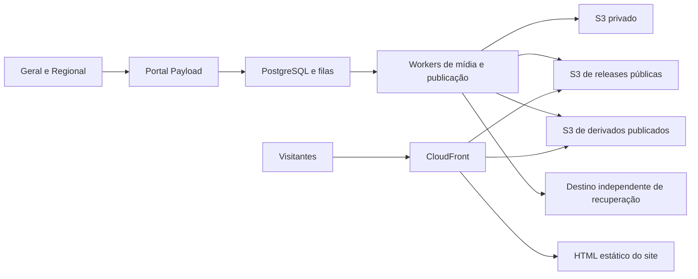
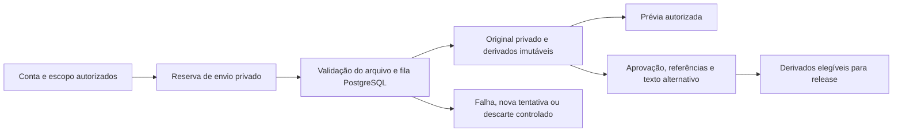
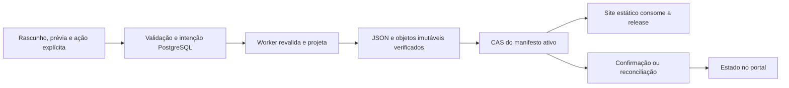
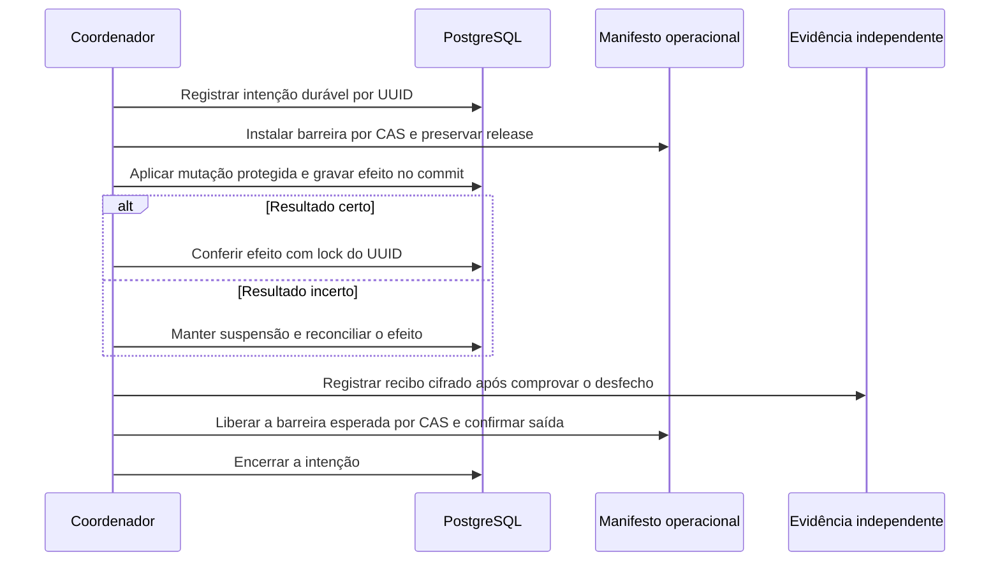
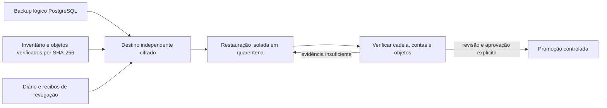
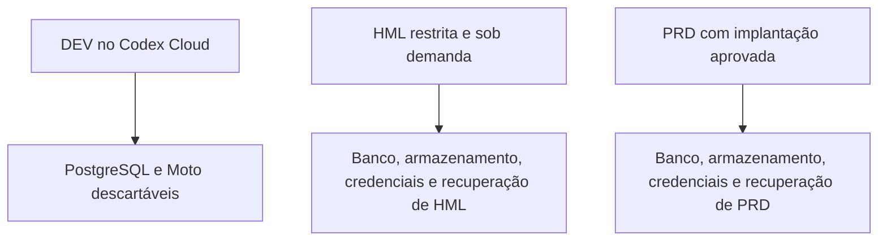
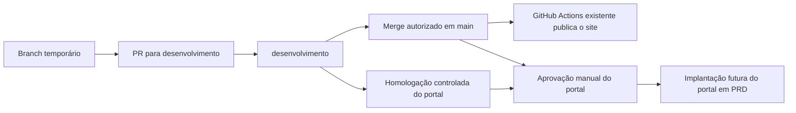

# Arquitetura do Portal Administrativo do MC Os Papas

## 1. Escopo e autoridade

Consolidação da Etapa 02I para orientar a implementação do MVP. A especificação rege os requisitos e as regras de negócio. As instruções do repositório regem o trabalho, os branches e o deploy. Os relatórios registram escopo e evidências da PoC. Para consistência distribuída, prevalece a rodada final da 02G.1. Para valores e premissas financeiras, prevalece a estimativa da 02H. [Especificação](ADMIN_PROJECT_SPEC.md) · [Instruções](AGENTS.md) · [Consistência final](ADMIN_POC_CONSISTENCY_FINAL_REPORT.md) · [Estimativa](ADMIN_COST_ESTIMATE.md)

| Status | Aplicação |
| --- | --- |
| Aprovado | Requisito ou decisão explicitamente aceito nas fontes. |
| Validado experimentalmente | Comportamento demonstrado no recorte e no ambiente da PoC. |
| Proposto | Candidato sujeito a decisão, medição ou aprovação. |
| Pendente de implementação | Comportamento que ainda precisa ser incorporado à solução definitiva. |
| Pendente de homologação | Comportamento cuja evidência representativa em HML ainda falta. |
| Bloqueador de produção | Condição cuja resolução é obrigatória antes da liberação de PRD. |

**Princípios aprovados.** Security First, menor custo operacional viável com teto total de R$ 50,00/mês, independência do site estático, simplicidade, dependências mínimas, privilégio mínimo, isolamento regional, experiência administrativa mobile-first, acessível e em português do Brasil, recuperação segura e testes antes da produção. Em inconsistências excepcionais, é aprovada a suspensão temporária das operações administrativas e publicações afetadas. A entrega pública continua na última release segura, respeitando as revogações confirmadas. [Especificação](ADMIN_PROJECT_SPEC.md) · [Consistência final](ADMIN_POC_CONSISTENCY_FINAL_REPORT.md) · [Estimativa](ADMIN_COST_ESTIMATE.md)

## 2. Arquitetura de referência e limites

| Situação | Composição e responsabilidade |
| --- | --- |
| Existente | Site Next.js exportado estaticamente em `web/`, publicado pelo GitHub Actions em S3 e CloudFront. O artefato público tem ciclo próprio. |
| Aprovado | Portal isolado em `admin/`, com Payload CMS, React, TypeScript e PostgreSQL. Regras de acesso nativas do Payload e validação no servidor. O site mantém a exportação estática. |
| Validado experimentalmente | Painel e API Payload em Next.js standalone, PostgreSQL real local, Moto simulando S3, filas duráveis em PostgreSQL, SDK S3, processamento Sharp e FFmpeg/FFprobe e leitor experimental de releases. Codex Cloud é o ambiente de desenvolvimento. |
| Proposto para HML e PRD | Neon PostgreSQL, Lambda Web Functions para o painel/API, Lambda Event Functions para workers, EventBridge Scheduler para reconciliação periódica limitada, S3 para mídia, releases e recuperação, CloudFront para entrega, CloudWatch para observabilidade, IAM para privilégios, Parameter Store para configuração protegida e KMS para criptografia. Priorizar eventos para iniciar o processamento. Justificar novos serviços com uma necessidade demonstrada. |

[Site e deploy](AGENTS.md) · [Workflow](.github/workflows/deploy-aws.yml) · [Fundação](ADMIN_POC_REPORT.md) · [Mídias](ADMIN_POC_MEDIA_REPORT.md) · [Publicação](ADMIN_POC_PUBLICATION_REPORT.md) · [Estimativa](ADMIN_COST_ESTIMATE.md)

### Contexto do sistema

### Aplicação lógica

O código experimental usa `admin/src/app` e `payload.config.ts` como entrada do painel/API, `access` para políticas, filtros e hooks, `media` para reservas e processamento, `publication` para fila, projeção e ativação e `security` para mutações, auditoria e recuperação. O esquema definitivo e suas migrações estão pendentes. A PoC de Agenda valida versões e um recorte de campos, relacionamentos e permissões. [Fundação](ADMIN_POC_REPORT.md) · [Acesso](ADMIN_POC_ACCESS_REPORT.md) · [Publicação](ADMIN_POC_PUBLICATION_REPORT.md) · [Consistência final](ADMIN_POC_CONSISTENCY_FINAL_REPORT.md)

O modelo conceitual separa contas, unidades, Diretoria, membros, Agenda, Eventos, Filantropia, mídia, auditoria e configurações globais. Unidades relacionam contas regionais, membros e conteúdo local. Um compromisso pode alimentar páginas geral e regional e servir de fonte opcional de um evento. A Diretoria pode vincular membro e unidade sob controle nacional. Mídias mantêm titularidade e vínculos explícitos, inclusive capa, galerias e pôster. Auditoria registra autoria e contexto. As coleções, seus endpoints e a projeção pública aplicam os mesmos limites de autorização, inclusive para efeitos indiretos. [Modelo e regras](ADMIN_PROJECT_SPEC.md) · [Acesso](ADMIN_POC_ACCESS_REPORT.md)

**Contrato operacional.** API devolve erros sanitizados. O painel deve comunicar progresso, conflito, falha e possibilidade de nova tentativa. Falhas transitórias seguem limites da fila e reconciliação idempotente. Falhas de autorização rejeitam a operação e estados incertos de segurança suspendem a atividade afetada. Separar configuração e credenciais por ambiente e função. Guardar segredos fora de Git, artefatos e logs. [Fundação](ADMIN_POC_REPORT.md) · [Publicação](ADMIN_POC_PUBLICATION_REPORT.md) · [Segurança](ADMIN_POC_SECURITY_REPORT.md) · [Consistência final](ADMIN_POC_CONSISTENCY_FINAL_REPORT.md)

**Runtime pendente de homologação.** O ensaio standalone ocorreu em Debian x86-64 com Node.js 24.22.3. Homologar Node.js 24 gerenciado compatível com o Payload (a partir de 24.22.3 na série 24), bootstrap no endpoint HTTP da Lambda, início a frio, concorrência e o pacote Linux Arm64. Empacotar e testar Sharp/libvips e FFmpeg/FFprobe nativos, memória, CPU, tempo e disco temporário. Medir TLS, limites, latência e recuperação das conexões reais a Neon. Workers com locks de sessão exigem conexão direta e controles transacionais precisam de ensaio com a topologia de conexões selecionada, incluindo o pooler quando aplicável. [Fundação](ADMIN_POC_REPORT.md) · [Mídias](ADMIN_POC_MEDIA_REPORT.md) · [Publicação](ADMIN_POC_PUBLICATION_REPORT.md) · [Consistência final](ADMIN_POC_CONSISTENCY_FINAL_REPORT.md)

## 3. Autorização e regras de negócio

- **Geral.** Administra unidades, contas, permissões, configurações globais, Diretoria, Filantropia e conteúdos regionais autorizados. Gerencia compromissos, eventos e destaques nacionais. Filantropia continua exclusiva do Geral quando há unidade responsável. [RF-01 a RF-10 e RN-06](ADMIN_PROJECT_SPEC.md)
- **Regional.** Uma conta individual ativa é vinculada a uma unidade. A unidade pode ter vários administradores. O Regional gerencia membros, compromissos, eventos, destaques locais e galerias autorizadas e pode publicar diretamente dentro do escopo. Em **Minha Sede**, edita somente Sobre a Sede, número do WhatsApp, Instagram, endereço, link da localização e imagem de capa. O sistema valida URLs e gera o link do WhatsApp a partir do número. [RF-04, RF-10 e RN-02 a RN-06 e RN-11](ADMIN_PROJECT_SPEC.md)
- **Identidade, titularidade e reversibilidade.** Contas e cadastros de membros são independentes. Membros têm nome de exibição ou apelido, patente, cargo opcional, unidade, ordenação e situação. Publicar membros e diretores exige foto e os respectivos campos obrigatórios. A ordem editorial é manual e acessível. O Geral transfere membros em operação explícita com histórico. A desativação de diretores, unidades e membros é reversível e preserva os registros e vínculos aprovados. A retirada da Diretoria preserva o cadastro de membro. Reaproveitar membro ou mídia regional na Diretoria exige ação autorizada do Geral. Na desativação efetiva de uma unidade, a regra aprovada na Etapa 03F.03 bloqueia o acesso administrativo dos Regionais vinculados, revoga suas sessões e impede operações sem autorização vigente. Preserva contas, situação individual, conteúdos, autoria e histórico. Revalidar operações pendentes conforme Security First e o protocolo da seção 6. A reativação permite novo login apenas para contas ainda habilitadas e autorizadas. Sessões revogadas permanecem inválidas. A implementação definitiva e a homologação continuam pendentes. [RF-03 a RF-05 e RN-07 a RN-10](ADMIN_PROJECT_SPEC.md)
- **Imposição no servidor.** Filtrar por conta ativa, perfil, unidade, ação, registro e campos, inclusive em listas, totais, APIs, prévias, versões, lote e endpoints próprios. Resolver titularidade no servidor, validar relacionamentos e impedir alteração indireta de conteúdo nacional ou de outra unidade. Restauro e despublicação de conteúdo exigem autorização vigente e auditoria. O restauro de conteúdo volta pelo fluxo de publicação. O rollback de uma release inteira e a revogação urgente no protocolo experimental são restritos ao Geral. [RN-03, RN-05, RN-18 e RN-20](ADMIN_PROJECT_SPEC.md) · [Acesso](ADMIN_POC_ACCESS_REPORT.md) · [Publicação](ADMIN_POC_PUBLICATION_REPORT.md)

| Conteúdo | Exigido para publicar | Obrigatório sob condição e campos opcionais |
| --- | --- | --- |
| Sedes e Regionais (RF-04) | Descrição (Sobre a Sede), capa e alt descritivo e não vazio para unidades com página pública própria, também em Minha Sede. | Permitir rascunhos incompletos. Subsedes Representativas sem página própria dispensam descrição e capa. Na migração, preservar referências históricas e encaminhar lacunas para revisão administrativa, sem inventar conteúdo nem despublicar automaticamente. |
| Agenda (RF-06) | Título, categoria, organizador, situação e informação temporal, com data inicial ou indicação explícita de data a definir. | Unidade quando regional. Data final, horário, local, descrição, link externo ou de mapa, imagem de divulgação e destaque são opcionais. Para registros históricos, identificar a data como parcial quando aplicável. Contempla apenas compromissos públicos, inclusive de vários dias. Cancelados podem ficar visíveis com a situação correta. |
| Eventos (RF-07) | Título, categoria, data ou período, descrição e imagem de capa. | Unidade quando regional e alt descritivo para cada imagem. Cidade, estado, galerias, vínculo com a Agenda e destaque são opcionais. Pode-se salvar rascunho sem capa. Um evento regional alimenta a página da unidade e a geral. |
| Filantropia (RF-08) | Título, cidade, estado, descrição e data, período ou ano. | Unidade quando responsável, autorização de divulgação da mídia incluída e alt descritivo das imagens. Instituição, tipo de doação ou ação, mídia, destaque, impacto e quantidade de beneficiários são opcionais. Registrar impacto e beneficiários apenas com informação confirmada. |

Em registros históricos, preservar a precisão conhecida da data. Cada compromisso ou evento regional tem uma origem única para as páginas geral e regional. Atentar para autorizações de mídia com crianças ou pessoas vulneráveis. Coletar apenas dados pessoais necessários. O MVP tem o escopo da especificação, com notícias, avisos e publicações editoriais reservados a evolução futura. [RF-06 a RF-09, RN-12 a RN-15 e critérios de aceite](ADMIN_PROJECT_SPEC.md)

## 4. Mídia

O servidor reserva cota, vincula a autorização de envio à conta e à titularidade nacional ou regional e expira a reserva de uso único em cinco minutos. O envio fica privado. Validar bytes, tipo real, tamanho, integridade e dimensões antes de gerar derivados. A fila PostgreSQL retoma processamento, com até seis tentativas por mídia na PoC. O original permanece privado e imutável. Somente derivados aprovados são projetados em releases. As prévias privadas exigem autorização. [Mídias](ADMIN_POC_MEDIA_REPORT.md) · [Publicação](ADMIN_POC_PUBLICATION_REPORT.md)

| Política experimental | Limite ou comportamento observado |
| --- | --- |
| Imagem | JPEG, PNG e WebP de um quadro, até 20 MiB e 32 MP decodificados. Sharp remove metadados sensíveis, mantém proporção e gera WebP de até 1920 px no lado maior e miniatura de até 320 px, sem ampliação. |
| Vídeo | MP4/MOV até 200 MiB, 120 s, 60 fps, eixo até 4096 px e área até 4096×2160. FFmpeg/FFprobe revalidam e geram MP4 H.264/YUV420p, AAC quando há áudio, faststart, até 1920×1080 ou 1080×1920. Remux quando compatível. Pôster automático WebP até 640 px. |
| Cotas e retenção | PoC limita originais e reservas a 256 MiB por âmbito e 512 MiB no total, dez reservas por minuto por conta, e aplica contenção e timeouts ao processamento. Cotas de derivados, disco, concorrência, retenção e descarte são pendentes. HEIC/HEVC ficam fora do recorte ensaiado. |
| Condições de referência | Imagens publicadas, inclusive reutilizadas, exigem alt descritivo e não vazio. O pôster personalizado deve existir, estar pronto e validado, pertencer ao mesmo âmbito autorizado e estar explicitamente aprovado para publicação, com alt descritivo. A entrega do pôster publicado repete as verificações e recusa referências legadas incompatíveis. A prévia pode usar pôster de rascunho autorizado no escopo. |

[Especificação](ADMIN_PROJECT_SPEC.md) · [Evidência e limites de mídia](ADMIN_POC_MEDIA_REPORT.md)

Validar referências, autorização e estado conjuntamente, inclusive sob concorrência. O descarte permanente segue procedimento controlado e preserva o que estiver referenciado por conteúdo ativo, rascunhos ou versões retidas. Uma revogação segura de mídia atualiza o manifesto e precisa alcançar o acesso público, incluindo objetos, URLs e cache de borda. Cópias externas permanecem fora do alcance desse controle. Homologar envio assinado direto, incluindo expiração, CORS, tamanho, replay e sobrescrita. O adaptador oficial S3 do Payload é uma alternativa condicionada aos mesmos controles. Aferir HEIC, vídeos grandes, processamento nativo Arm64 e comportamento de S3 e CloudFront reais. [RF-09, RN-15 e RN-22](ADMIN_PROJECT_SPEC.md) · [Mídias](ADMIN_POC_MEDIA_REPORT.md) · [Publicação](ADMIN_POC_PUBLICATION_REPORT.md)

## 5. Publicação de conteúdo

A arquitetura híbrida candidata preserva o HTML estático e acrescenta JSON público versionado, releases imutáveis e um manifesto ativo. A projeção usa lista explícita de campos públicos e exclui segredos, dados administrativos, rascunhos e referências privadas. O usuário salva o rascunho, visualiza a prévia e publica explicitamente. O servidor valida autoridade, campos e vínculos, detecta conflito de versão e persiste a intenção de publicação. A sincronização é automática, com retorno de estado e resultado ao painel. [RF-12 e RN-18 a RN-21](ADMIN_PROJECT_SPEC.md) · [Publicação](ADMIN_POC_PUBLICATION_REPORT.md)

O worker revalida a autorização atual do operador para a operação original, com dados persistidos e confiáveis, tanto na nova tentativa quanto antes de ativar uma release. A fila impede sucessores diante de resultado incerto. Os artefatos são verificados por digest e gravados de forma imutável. A troca do manifesto usa comparação e troca condicional (CAS) por ETag, com linhagem, revisão monotônica e geração. A reconciliação reconhece ativações que já ocorreram, sem repeti-las ou desfazê-las após mudança de autorização. Se uma ativação não autorizada for rejeitada, a release pública anterior permanece. Um rollback autorizado gera uma nova revisão e preserva as revogações confirmadas. O site lê o manifesto e os artefatos pelo caminho público, independente da disponibilidade do Payload ou do PostgreSQL. [Publicação](ADMIN_POC_PUBLICATION_REPORT.md) · [Consistência final](ADMIN_POC_CONSISTENCY_FINAL_REPORT.md)

**Isolamento de origens.** O workflow do site executa `aws s3 sync --delete`, que pode remover releases e mídias se o destino se sobrepuser. Usar destinos isolados, preferencialmente buckets separados ou prefixos comprovadamente protegidos por escopo de sincronização e IAM. Segregar artefatos do site, releases, derivados públicos, mídia privada e recuperação. A candidata descrita na PoC prevê destinos distintos para releases e derivados públicos, com acesso de escrita do worker. Projetar cache curto ou revalidação do ponteiro e cache de artefatos imutáveis compatível com revogação. Homologar OAC, acesso direto, invalidação e URLs de objetos revogados. [Workflow](.github/workflows/deploy-aws.yml) · [Publicação](ADMIN_POC_PUBLICATION_REPORT.md) · [Consistência final](ADMIN_POC_CONSISTENCY_FINAL_REPORT.md)

**Rotas e descoberta.** JSON atualiza as páginas preparadas para consumi-lo. Rotas de exportação estática, incluindo parâmetros de `generateStaticParams`, HTML indexável, sitemap e metadados sociais são gerados no build. Mudanças estruturais nesses itens podem exigir um fluxo de geração estática separado da publicação cotidiana. Por exemplo, para uma nova sede, validar o slug aprovado e gerar a rota a partir de uma release fixa. Inventariar URLs, identificadores, âncoras, galerias, SEO e metadados antes da migração e comparar a saída pública em HML. [Especificação](ADMIN_PROJECT_SPEC.md) · [Publicação](ADMIN_POC_PUBLICATION_REPORT.md)

## 6. Segurança e consistência distribuída

**Protocolo final validado experimentalmente.** Registrar uma intenção durável por UUID, com uma pendência por ambiente. A pendência veda novas operações concorrentes afetadas. A barreira é instalada por CAS no manifesto e confirmada por leitura antes da mutação. Preserva a última release e identifica por geração qual ativação venceu antes da mudança. Um worker com ETag anterior perde a precondição. Ao obter nova geração, revalida permissões e mídias. O guard SQL exige correspondência entre intenção protegida, entidade, linha, operação e transação. O efeito é gravado na mesma transação da mutação. O ponto efetivo da alteração de autoridade é o commit no PostgreSQL. O protocolo cobre inativação de conta ou unidade, mudanças de perfil e lotação, transferência de membro e retirada de aprovação de mídia. [Consistência final](ADMIN_POC_CONSISTENCY_FINAL_REPORT.md)

Para concluir, adquirir o lock transacional do UUID, verificar o efeito e gravar o recibo cifrado no destino independente. Liberar por CAS apenas a barreira do UUID e da geração esperados, confirmar a saída por leitura e encerrar a intenção. Se o resultado ficar incerto, manter a suspensão e reconciliar pelo estado durável. O registro distingue aplicação e aborto. PostgreSQL e S3 têm commits distintos. No ensaio, o ordenamento impediu a ativação por worker obsoleto depois da alteração de autoridade e permitiu reconciliar ativações anteriores ao cercamento. [Consistência final](ADMIN_POC_CONSISTENCY_FINAL_REPORT.md)

**Revogação pública.** Gravar evento cifrado, reservar slot imutável, avançar por CAS o índice autenticado independente, aplicar CAS no manifesto operacional, observar o resultado e gravar recibo imutável. O CAS operacional é o ponto efetivo da revogação. Vincular UUID, revisão, ETag base, digest do evento e desfecho à evidência. Antes de nova ativação ou mutação, conferir índice, cauda e última revogação confirmada. A recuperação verifica toda a cadeia. Lacuna, ausência de recibo, evidência indisponível ou regressão impede confirmação ou promoção, inclusive se a cadeia truncada parecer válida isoladamente. [Consistência final](ADMIN_POC_CONSISTENCY_FINAL_REPORT.md)

**Fronteiras pendentes.** Restringir por IAM alteração, exclusão e regressão do manifesto, índice e recibos. Usar versionamento e proteção de retenção compatíveis com a política aprovada. Restringir o papel SQL do runtime de forma que só operações autorizadas escrevam evidências ou alterem controles. Homologar papéis de migração, execução e recuperação. O leitor público depende da integridade da origem operacional. A proteção contra alteração coordenada do destino operacional e do de recuperação depende dessas fronteiras de produção. Confirmar políticas, condições e falhas reais em AWS e Neon. [Consistência final](ADMIN_POC_CONSISTENCY_FINAL_REPORT.md) · [Estimativa](ADMIN_COST_ESTIMATE.md)

| Controle | Estado e aplicação |
| --- | --- |
| Identidade e sessões | Aprovados e-mail único, senha, conta ativa, cadastro restrito e recuperação por e-mail. A PoC exercitou login e revogação de sessões após desativação ou mudança de autoridade e protegeu o último Geral ativo sob concorrência. Recuperação por e-mail, configuração segura de cookies, CSRF, limitação de tentativas, verificação de sessão e avaliação de MFA exigem implementação ou homologação definitiva. |
| Autorizações e validação | Validados experimentalmente filtros, hooks, relacionamentos, revalidação de publicação, validação de mídia e cotas iniciais. Aplicar privilégio mínimo, escopo e limites em todo o MVP. Revisar abuso de login, APIs, reservas, processamento e recuperação. |
| Auditoria | Requisito aprovado para registro de autor, operação, data, registro, escopo e mudanças pertinentes, sem senhas, tokens ou segredos. O acesso regional é filtrado e a escrita ordinária pela API é bloqueada na PoC. Homologar imutabilidade pelos papéis reais, retenção e revisão de eventos. |
| Credenciais e serviço | Propostos isolamento IAM por ambiente e função, SQL com privilégios segregados, OAC, Parameter Store e KMS. Verificar rotação, acesso de emergência, ausência de segredos em logs/artefatos e permissões negativas em HML. |
| Operação e incidentes | Propostos logs estruturados e sanitizados com correlação por operação e release, métricas e alertas CloudWatch para autorização, fila atrasada, barreira pendente, evidência ausente, falha de backup, restauração, capacidade e custos. Em incidente, conter o escopo afetado, preservar evidências, sustentar a última release segura e retomar mediante reconciliação comprovada. |

[Especificação](ADMIN_PROJECT_SPEC.md) · [Acesso](ADMIN_POC_ACCESS_REPORT.md) · [Segurança](ADMIN_POC_SECURITY_REPORT.md) · [Consistência final](ADMIN_POC_CONSISTENCY_FINAL_REPORT.md)

## 7. Backup e recuperação

O ensaio usa backup lógico do PostgreSQL, inventário de objetos e versões, verificação de integridade por SHA-256 e deduplicação de binários pelo digest no destino de recuperação independente. A criptografia experimental usa AES-256-GCM. A infraestrutura candidata deve proteger chaves, cópias e recibos com privilégios separados e verificar o histórico independente de revogação, inclusive após a data do backup. [Segurança](ADMIN_POC_SECURITY_REPORT.md) · [Consistência final](ADMIN_POC_CONSISTENCY_FINAL_REPORT.md) · [Estimativa](ADMIN_COST_ESTIMATE.md)

**Procedimento.** Suspender operações afetadas, preservar evidências, verificar inventário e os objetos e restaurar em destino isolado e em quarentena. Invalidar sessões, revisar contas, atribuições e segredos, suspender jobs históricos e conferir a cadeia de revogação. A restauração de ensaio preserva o manifesto da origem. Evidência incompleta ou regredida mantém a quarentena. A promoção é uma operação explícita, sujeita a revisão humana e aprovação, seguida de reconciliação e ativação autorizada em nova geração. A promoção operacional e o exercício completo em ambiente real continuam pendentes. [Segurança](ADMIN_POC_SECURITY_REPORT.md) · [Consistência final](ADMIN_POC_CONSISTENCY_FINAL_REPORT.md)

**Política proposta.** Reter cópias diárias por sete dias, semanais por quatro semanas e mensais por três meses, até três releases anteriores elegíveis e auditoria por 12 meses. Exercitar a restauração mensalmente. Preservar objetos necessários aos acervos e à recuperação verificável. RPO de 24 horas e RTO de 4 horas são metas sujeitas a aprovação e ensaio com volume representativo. Alertar por atraso, corrupção, perda de evidência, falha de backup ou ultrapassagem dos objetivos acordados. [Segurança](ADMIN_POC_SECURITY_REPORT.md) · [Estimativa](ADMIN_COST_ESTIMATE.md)

## 8. Ambientes e CI/CD

| Ambiente | Limite aprovado |
| --- | --- |
| DEV | Codex Cloud, PostgreSQL e Moto descartáveis, dados fictícios. |
| HML | Ambiente independente, restrito e sob demanda quando viável. Banco, armazenamento, credenciais e recuperação separados. Usar dados fictícios ou explicitamente sanitizados. |
| PRD | Ambiente oficial, com banco, armazenamento, credenciais e recuperação independentes. Implantação do portal sujeita a aprovação manual. Após implantação, o conteúdo autorizado segue publicação direta pelo portal. |

[Instruções](AGENTS.md) · [Especificação](ADMIN_PROJECT_SPEC.md) · [Segurança](ADMIN_POC_SECURITY_REPORT.md) · [Estimativa](ADMIN_COST_ESTIMATE.md)

Usar branches temporários, com PR para `desenvolvimento`. A promoção de código passa por `desenvolvimento` e `main`, sem branch permanente de homologação. O GitHub Actions existente publica o site em S3 e CloudFront após o merge de `desenvolvimento` em `main`. O fluxo futuro do portal exige verificações, permissões de implantação por ambiente, evidência de HML e aprovação manual para PRD. A escolha do mecanismo de identidade e dos gatilhos do portal está pendente. [Instruções](AGENTS.md) · [Workflow existente](.github/workflows/deploy-aws.yml) · [Segurança](ADMIN_POC_SECURITY_REPORT.md)

## 9. Arquitetura financeira

Teto de **R$ 50,00/mês para toda a infraestrutura** e **R$ 0,00 de gasto adicional autorizado** nesta etapa. Base AWS histórica de **US$ 0,56/mês** de agosto a outubro de 2026 e câmbio de planejamento de **R$ 6,00/US$**. Valores mensais totais conhecidos são parciais e condicionais à região efetiva, à carga, às franquias e às cobranças remanescentes. O modelo mantém duas chaves KMS gerenciadas pelo cliente. Alternativas exigem decisão futura, proteção equivalente demonstrada e nova avaliação de custo. [Estimativa](ADMIN_COST_ESTIMATE.md)

| Premissa | Leve | Moderado | Intenso |
| --- | ---: | ---: | ---: |
| Base parcial com Neon Free | R$ 17,90 | R$ 23,29 | R$ 36,95 |
| Contingência com Neon Launch em HML e PRD | R$ 25,12 | R$ 43,97 | R$ 96,77 |

Com Neon Free, o crescimento de armazenamento no cenário intenso chega a **R$ 49,64 no mês 12**, ainda parcial. Confirmar consumo real, franquias, retenção, rede, DNS, renovação do domínio, câmbio, tributos, GitHub e condições de faturamento. Monitorar projeção e alertas por faixa. Reduzir carga não essencial ao se aproximar do teto, com preservação dos controles de segurança, recuperação e entrega pública. [Estimativa](ADMIN_COST_ESTIMATE.md)

## 10. Validação e critérios obrigatórios para produção

A rodada 02G.1 final reportou **68 testes de integração aprovados**, com 15 de acesso, 15 de mídia, 17 de publicação, 12 de segurança e 9 de consistência. Também reportou aprovação de TypeScript, ESLint, build e inicialização standalone. A execução foi local com PostgreSQL real e Moto, incluindo falhas injetadas e encerramento de sessão do worker. A Etapa 02I verifica a documentação com base nessas evidências. Cada critério abaixo requer evidência rastreável em condições representativas de HML antes da liberação. [Resultados finais](ADMIN_POC_CONSISTENCY_FINAL_REPORT.md)

| Requisito ou risco | Controle arquitetural | Fonte | Estado experimental | Trabalho restante | Evidência exigida em HML | Critério de produção |
| --- | --- | --- | --- | --- | --- | --- |
| RF-01, RF-02, RF-10. Autenticação, sessões e painel | Conta ativa, sessão protegida, escopo na visão e proteção do último Geral | [Especificação](ADMIN_PROJECT_SPEC.md) · [Acesso](ADMIN_POC_ACCESS_REPORT.md) · [Segurança](ADMIN_POC_SECURITY_REPORT.md) | Login, escopo, revogação e concorrência validados | Recuperação, cookies, CSRF, rate limit, avaliação de MFA e cobertura do painel | Testes de recuperação, sessões, abuso, visões, APIs e concorrência, incluindo bloqueio e sessões revogadas na desativação de unidade, revalidação de operações pendentes e login elegível na reativação | Bloqueador de produção. Controles aprovados e verificados no portal definitivo. |
| RF-03 a RF-08. Titularidade, regras, dados históricos | Políticas nativas, validação de campos/vínculos e projeção por origem | [Especificação](ADMIN_PROJECT_SPEC.md) · [Acesso](ADMIN_POC_ACCESS_REPORT.md) | Isolamento em recorte validado | Coleções, migração, reversibilidade, validação e precisão histórica | Cenários de aceite por perfil, incluindo validações de publicação de unidades, rascunhos incompletos e tratamento das lacunas do acervo migrado | Bloqueador de produção. Sem acesso cruzado e com requisitos de negócio cumpridos. |
| RF-09. Envio e processamento de mídia | Staging privado, limites, validação real, derivados, consentimento, alt e pôster | [Mídias](ADMIN_POC_MEDIA_REPORT.md) · [Especificação](ADMIN_PROJECT_SPEC.md) | Processamento sintético e autorizações validados | Envio assinado, política de formatos e retenção, limites finais e carga Arm64 | Testes positivos e negativos com S3 real, carga, arquivos limites e formatos propostos | Bloqueador de produção. Contenção, privacidade, acessibilidade e cotas comprovadas. |
| RF-11. Auditoria | Trilha sanitizada e protegida, com consulta no escopo | [Especificação](ADMIN_PROJECT_SPEC.md) · [Segurança](ADMIN_POC_SECURITY_REPORT.md) | Proteção da API e registros ensaiados | Permissões definitivas, retenção e revisão operacional | Teste de adulteração por papel ordinário e busca por autoria e escopo | Bloqueador de produção. Integridade e minimização verificadas. |
| RF-12. Publicação, falhas e consistência | Intenção durável, revalidação, barreira CAS, evidência independente e reconciliação | [Publicação](ADMIN_POC_PUBLICATION_REPORT.md) · [Consistência final](ADMIN_POC_CONSISTENCY_FINAL_REPORT.md) | Validado experimentalmente com PostgreSQL/Moto | Integração definitiva e política de quarentena operacional | Falhas e corridas reais em AWS e Neon, incluindo escrita tardia, perda de resposta, commit incerto e retomada | Bloqueador de produção. Preservar a release segura e o histórico confirmado em todos os cenários. |
| Compatibilidade AWS/Neon e conexões PostgreSQL | TLS, conexão direta para locks de sessão e pool apropriado por operação | [Fundação](ADMIN_POC_REPORT.md) · [Consistência final](ADMIN_POC_CONSISTENCY_FINAL_REPORT.md) | PostgreSQL local validado | Seleção de topologia, limites e reconexão | Ensaios reais de conexões diretas, pooler, locks, falhas, latência e concorrência | Bloqueador de produção. Comportamento transacional e capacidade comprovados no alvo. |
| Lambda Web Functions e binários Linux Arm64 | Artefato compatível, workers com recursos limitados | [Fundação](ADMIN_POC_REPORT.md) · [Mídias](ADMIN_POC_MEDIA_REPORT.md) | Standalone x86-64 e ferramentas locais | Bootstrap, pacote Arm64, Sharp/libvips, FFmpeg e FFprobe | Dados de runtime gerenciado, arranque, pico de carga, processamento e custos | Bloqueador de produção. Runtime, ferramentas e limites verificados. |
| IAM, OAC, SQL, manifesto e recibos | Privilégios segregados, condições de escrita e retenção protegida | [Consistência final](ADMIN_POC_CONSISTENCY_FINAL_REPORT.md) · [Estimativa](ADMIN_COST_ESTIMATE.md) | Guards, CAS e verificação local exercitados | Políticas reais, papéis SQL e proteção contra alteração indevida | Testes de escrita, leitura, exclusão e regressão negadas, e revisão independente de políticas | Bloqueador de produção. Runtime ordinário incapaz de alterar controles ou evidências. |
| CloudFront, cache, revogação e acesso direto | Origem protegida e invalidação ou expiração compatível com revogação | [Publicação](ADMIN_POC_PUBLICATION_REPORT.md) · [Consistência final](ADMIN_POC_CONSISTENCY_FINAL_REPORT.md) | Revogação e rollback no leitor PoC | Configurar origens, cache, invalidação e proteção de URLs | Testar cache aquecido, Range, objetos antigos e acesso direto após revogação | Bloqueador de produção. Revogação efetiva no objetivo homologado e entrega pública disponível. |
| Backup e restauração | Inventário, criptografia, histórico independente e quarentena | [Segurança](ADMIN_POC_SECURITY_REPORT.md) · [Consistência final](ADMIN_POC_CONSISTENCY_FINAL_REPORT.md) | Restauração isolada e falhas locais exercitadas | Política aprovada, promoção, alertas, chaves e ensaio real | Exercício integral com perda ou corrupção, aprovação, tempo e ponto recuperado | Bloqueador de produção. Recuperação segura e metas aprovadas atingidas. |
| Isolamento de ambientes e colisão de deploy | Bancos, destinos, permissões e recuperação separados | [Instruções](AGENTS.md) · [Workflow](.github/workflows/deploy-aws.yml) · [Segurança](ADMIN_POC_SECURITY_REPORT.md) | Isolamento local demonstrado | Configuração de HML/PRD, permissões e aprovação manual | Negativas de acesso cruzado e evidência de que deploy do site preserva releases | Bloqueador de produção. Fronteiras e procedimento de promoção aceitos. |
| SEO, URLs e independência pública | Exportação estática, contrato JSON e inventário da migração | [Especificação](ADMIN_PROJECT_SPEC.md) · [Publicação](ADMIN_POC_PUBLICATION_REPORT.md) | Leitor PoC independente exercitado | Integração web e validação de rotas, cache e metadados | Comparativo de URLs, âncoras, galerias, HTML, sitemap e metadados, inclusive sem admin/banco | Bloqueador de produção. Preservação dos elementos públicos e disponibilidade comprovadas. |
| Custo real e capacidade | Cotas, alarmes, HML sob demanda e revisão de gastos | [Estimativa](ADMIN_COST_ESTIMATE.md) | Hipóteses e amostras locais | Inventário, medição de carga e total faturável | Projeção com consumo medido, tarifas aplicáveis e contingência aceitável | Bloqueador de produção. Total compatível com R$ 50,00 e gasto efetivo autorizado. |

## 11. Registros de decisão

As alternativas abaixo registram caminhos históricos ou comparações para orientar uma eventual revisão. Adoção futura depende de evidência e autorização.

| Tema e contexto | Decisão | Fundamentação | Consequência | Alternativas | Estado | Fonte |
| --- | --- | --- | --- | --- | --- | --- |
| CMS em aplicação isolada | Adotar Payload CMS | Painel nativo, TypeScript e integração Next.js/PostgreSQL | Manter migrações e pacote do portal separados | Strapi, registrado na documentação histórica | Aprovado. Fundação validada experimentalmente. | [Especificação](ADMIN_PROJECT_SPEC.md) · [Fundação](ADMIN_POC_REPORT.md) · [Modelo histórico](STRAPI_CONTENT_MODEL.md) |
| Persistência e operações concorrentes | Adotar PostgreSQL, com Neon como candidato | Relações, transações e locks atendem às invariantes | Dimensionar conexões diretas e pooler | PostgreSQL local para DEV ou hospedagem gerenciada alternativa se houver bloqueio | Aprovado para PostgreSQL. Neon pendente de homologação. | [Fundação](ADMIN_POC_REPORT.md) · [Segurança](ADMIN_POC_SECURITY_REPORT.md) · [Estimativa](ADMIN_COST_ESTIMATE.md) |
| Autorização por unidade | Usar políticas nativas do Payload e validadores no servidor | Aplica restrições inclusive na API, em campos e relacionamentos | Cobrir caminhos customizados e vínculos indiretos | Política em serviço externo exigiria justificar duplicação e dependência | Aprovado. Isolamento validado experimentalmente em recorte. | [Acesso](ADMIN_POC_ACCESS_REPORT.md) · [Especificação](ADMIN_PROJECT_SPEC.md) |
| Continuidade institucional | Preservar o site estático existente | Entrega pública independe do painel e do banco | Integrar por artefatos públicos e preservar URLs | Renderização pública dependente do CMS introduziria acoplamento operacional | Aprovado. Integração definitiva pendente. | [Especificação](ADMIN_PROJECT_SPEC.md) · [Publicação](ADMIN_POC_PUBLICATION_REPORT.md) |
| Publicação cotidiana | Usar HTML estático e JSON versionado com manifesto | Permite atualização automática com troca controlada | Exige consumidor compatível e processo para mudanças estruturais | Rebuild por publicação ou consulta direta ao CMS | Aprovado como caminho candidato. Validado experimentalmente em recorte. | [Publicação](ADMIN_POC_PUBLICATION_REPORT.md) |
| Colisão e exposição no S3 | Isolar artefatos, projeções públicas, mídia privada e recuperação | Restringe exclusão, exposição e compartilhamento de privilégios | Provisionamento futuro exige revisão de escopo e custo | Buckets separados ou prefixos isolados com evidência equivalente | Proposto. Topologia e políticas pendentes de homologação. | [Publicação](ADMIN_POC_PUBLICATION_REPORT.md) · [Segurança](ADMIN_POC_SECURITY_REPORT.md) |
| Entrega assíncrona durável | Usar filas PostgreSQL | Persiste a intenção junto ao estado e contém dependências | Dimensionar retries, locks e reconciliação | Fila gerenciada somente com necessidade demonstrada | Validado experimentalmente. Capacidade pendente de homologação. | [Mídias](ADMIN_POC_MEDIA_REPORT.md) · [Publicação](ADMIN_POC_PUBLICATION_REPORT.md) · [Estimativa](ADMIN_COST_ESTIMATE.md) |
| Execução com baixo custo | Avaliar Web Functions e Event Functions | Dimensiona painel e workers separadamente | Confirmar Node, Arm64, rede, limites e custo | Serviço Node.js gerenciado ou instância pequena se houver bloqueio | Proposto. Standalone validado experimentalmente. | [Fundação](ADMIN_POC_REPORT.md) · [Estimativa](ADMIN_COST_ESTIMATE.md) |
| Separação entre commits PostgreSQL e S3 | Suspender operações afetadas e coordenar por barreira e geração | Define ordenamento e evita ativação obsoleta | Pode reduzir temporariamente a disponibilidade administrativa | Revalidação isolada antes do CAS deixou janela no ensaio anterior | Security First aprovado. Protocolo final validado experimentalmente. | [Consistência anterior](ADMIN_POC_CONSISTENCY_REPORT.md) · [Consistência final](ADMIN_POC_CONSISTENCY_FINAL_REPORT.md) |
| Evidência de revogação | Guardar slots, índice e recibos independentes | Detecta perda, truncamento e regressão operacional | Exige proteção, verificações de cadeia e orçamento de operações | Diário dependente apenas do manifesto operacional foi superado | Validado experimentalmente. Fronteiras de produção pendentes. | [Consistência anterior](ADMIN_POC_CONSISTENCY_REPORT.md) · [Consistência final](ADMIN_POC_CONSISTENCY_FINAL_REPORT.md) |
| Recuperação com possível regressão de estado | Restaurar em quarentena e exigir aprovação para promoção | Impede reativar sessões, trabalhos ou conteúdo revogado | Requer exercício completo e revisão humana | Restaurar diretamente sobre o ambiente ativo colocaria em risco a release e as revogações | Quarentena validada experimentalmente. Promoção, retenção e metas pendentes. | [Segurança](ADMIN_POC_SECURITY_REPORT.md) · [Consistência final](ADMIN_POC_CONSISTENCY_FINAL_REPORT.md) |
| Ambientes com níveis de confiança distintos | Segregar DEV, HML e PRD | Limita propagação de falhas e exposição de dados | Usar dados controlados, credenciais por ambiente e HML sob demanda | Compartilhamento de banco, armazenamento ou credenciais viola as fronteiras | Aprovado. Segregação real pendente de homologação. | [Segurança](ADMIN_POC_SECURITY_REPORT.md) · [Estimativa](ADMIN_COST_ESTIMATE.md) |
| Restrição financeira | Teto de R$ 50,00, menor custo viável e acompanhamento de consumo | Mantém viabilidade e preserva segurança | Medir custos reais e reavaliar se a contingência exceder o teto | Planos pagos e alternativas de chaves requerem avaliação e proteção equivalente | Teto aprovado. Estimativa parcial e homologação pendente. | [Estimativa](ADMIN_COST_ESTIMATE.md) |

## 12. Reconciliação das fontes

| Divergência ou diferença de alcance | Tratamento |
| --- | --- |
| A modelagem histórica menciona Strapi | A decisão atual é Payload CMS conforme a especificação e a PoC de fundação. [Modelo histórico](STRAPI_CONTENT_MODEL.md) · [Especificação](ADMIN_PROJECT_SPEC.md) · [Fundação](ADMIN_POC_REPORT.md) |
| A primeira rodada de consistência deixa uma janela entre autorização e ativação e depende do manifesto para reconciliar revogações | O protocolo final ordena localmente a mutação, cerca workers obsoletos e exige evidência independente. Produção ainda depende da proteção das duas origens e dos privilégios reais. [Consistência anterior](ADMIN_POC_CONSISTENCY_REPORT.md) · [Consistência final](ADMIN_POC_CONSISTENCY_FINAL_REPORT.md) |
| Contagens e estimativas de etapas anteriores retratam rodadas e premissas diferentes | Usar os 68 testes da rodada final sem somar rodadas. Usar os valores parciais da 02H. A composição dos valores preliminares está indisponível para comparação item a item. [Consistência final](ADMIN_POC_CONSISTENCY_FINAL_REPORT.md) · [Estimativa](ADMIN_COST_ESTIMATE.md) |
| Escopo do rollback de release experimental e do restauro de conteúdo aprovado | Preservar as duas operações e respectivas autorizações. [Especificação](ADMIN_PROJECT_SPEC.md) · [Publicação](ADMIN_POC_PUBLICATION_REPORT.md) |
| Bloqueio de acesso de Regionais de unidade desativada | A salvaguarda descrita na PoC foi aprovada como regra de negócio na Etapa 03F.03. Implementação definitiva e homologação continuam pendentes. [Especificação](ADMIN_PROJECT_SPEC.md) · [Evidência da PoC](ADMIN_POC_SECURITY_REPORT.md) |

## 13. Roteiro de implementação

| Etapa | Entrega aprovada no roteiro | Dependência e resultado esperado |
| --- | --- | --- |
| 03 | Design System e UX/UI | Usar os fluxos desta arquitetura e os critérios da especificação como entrada para componentes acessíveis e protótipos mobile-first em tema escuro e português do Brasil. |
| 04 | Fundação do Payload CMS | Estabelecer esquema, migrações, configuração, fronteiras e testes de integração a partir da arquitetura e dos fluxos aprovados. |
| 05 | Autenticação e permissões | Com a fundação, concluir identidade, contas, sessões, autorização nacional e regional e respectivas negativas. |
| 06 | Gestão da Diretoria | Usar a autorização nacional e validar foto, ordenação, vínculo opcional e preservação da autonomia da Diretoria. |
| 07 | Gestão de sedes e membros | Com a base de permissões, implementar Minha Sede, membros, transferências e inativação reversível. Validar vínculos com a Diretoria. |
| 08 | Agenda e eventos | Com titularidade regional e contratos de mídia definidos, implementar projeções por origem, datas parciais, vínculos e critérios de capa. |
| 09 | Filantropia e mídias | Completar pipeline de mídia e integrar fotos, capas, galerias e pôsteres dos domínios. Implementar consentimento e campos opcionais de Filantropia. |
| 10 | Integração com o site institucional | Após estabilizar o contrato de projeção e as referências, migrar conteúdo e validar releases, isolamento de destinos, URLs e SEO. |
| 11 | Auditoria e homologação | Consolidar evidências de HML, testes de privilégios e falhas, recuperação, custos e operação. Os controles são implementados desde a fundação e exercitados a cada etapa pertinente. |
| 12 | Implantação em produção | Depende do encerramento dos bloqueadores, aceitação das evidências de HML e aprovação manual da implantação. |

[Especificação e numeração oficial](ADMIN_PROJECT_SPEC.md) · [Bloqueios de infraestrutura e custo](ADMIN_COST_ESTIMATE.md)

**Próxima etapa recomendada.** Na Etapa 03, projetar em `ADMIN_DESIGN_SYSTEM.md` os fluxos de Geral e Regional para Minha Sede, rascunho, prévia, publicação, mídia e recuperação de falhas. Prototipar também ausência de permissão, status de fila, conflito de edição e suspensão de operações pela barreira de segurança. Validar navegação por teclado, contraste e experiência em telas pequenas com os critérios de aceite. [Especificação](ADMIN_PROJECT_SPEC.md) · [Consistência final](ADMIN_POC_CONSISTENCY_FINAL_REPORT.md)
