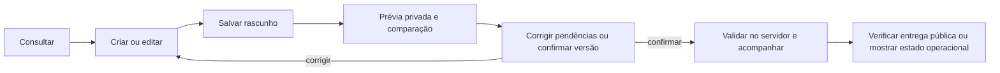

# Design System do Portal Administrativo do MC Os Papas

## 1. Escopo e princípios — 03A

A Etapa 03H consolida as decisões de UX/UI das etapas 03A a 03G. Esta é a referência para a implementação da interface definitiva. A especificação mantém a autoridade sobre requisitos, regras e critérios de aceite. A arquitetura rege os limites técnicos e os bloqueadores de produção. A estimativa rege as premissas financeiras. [Instruções do repositório](AGENTS.md) · [Especificação](ADMIN_PROJECT_SPEC.md) · [Arquitetura](ADMIN_ARCHITECTURE.md) · [Estimativa](ADMIN_COST_ESTIMATE.md)

| Estado | Leitura |
| --- | --- |
| **Decisão de UX/UI** | Diretriz visual ou de interação consolidada para orientar a implementação. Os protótipos são conceituais. |
| **Proposta para avaliação** | Política ou solução admitida para avaliação posterior. Sua adoção depende de definição técnica, autorização ou evidência, conforme o caso. |
| **Evidência da PoC** | Comportamento demonstrado no ambiente e no recorte do relatório indicado. |
| **Pendente de implementação ou homologação** | Trabalho necessário no produto definitivo ou validação representativa ainda em aberto. A seção 14 explicita os bloqueadores de produção. |

- **Mobile First e Accessibility First.** Uma única aplicação responsiva, com interface em português do Brasil, dimensionada primeiro para telas pequenas e operável por teclado, toque e tecnologias assistivas. A meta é WCAG 2.2 AA.
- **Security First.** Autorização e validação no servidor, privilégios mínimos, isolamento regional e minimização de dados pessoais. Em inconsistência excepcional, suspender as operações afetadas e preservar a última release pública segura, respeitando as revogações confirmadas.
- **Performance First.** Carregar de forma progressiva, priorizar conteúdo e comandos da tarefa, otimizar mídia e reutilizar componentes nativos do Payload CMS quando atenderem ao comportamento e à acessibilidade previstos. Justificar customizações pela necessidade e pelo custo de manutenção. Manter dependências e serviços externos no mínimo.
- **Produtividade e previsibilidade.** Adotar controles consistentes, confirmar alterações na medida do impacto, favorecer operações reversíveis e informar progresso, falhas e ações disponíveis. Administradores autorizados mantêm o conteúdo do site pelo portal, sem programação ou acesso a GitHub, Codex, AWS ou Neon. [Especificação](ADMIN_PROJECT_SPEC.md) · [Arquitetura](ADMIN_ARCHITECTURE.md)

## 2. Identidade e tokens — 03B

**Dark Premium** é o tema administrativo aprovado. Usar o brasão institucional nos pontos de identificação, como a autenticação.

| Token semântico | Valor | Aplicação |
| --- | --- | --- |
| Fundo principal | `#0B0B0B` | Fundo da aplicação e texto escuro dos botões dourados. |
| Superfície de navegação | `#141414` | Menu lateral e áreas de navegação. |
| Superfície de conteúdo | `#1C1C1C` | Cards e formulários. |
| Superfície elevada | `#242424` | Diálogos e áreas elevadas. |
| Ação primária | `#F2B705` | Botão principal e realce, com texto escuro no preenchimento. |
| Destaque e foco | `#FFD447` | Anel de foco em superfícies escuras e destaques pontuais. |
| Texto principal | `#FFFFFF` | Títulos, rótulos e texto principal sobre superfícies escuras. |
| Texto secundário | `#A1A1A1` | Descrições, metadados e texto auxiliar em superfícies escuras. |
| Borda decorativa | `#333333` | Divisores que dispensam contraste funcional. |
| Borda funcional | `#727272` | Limites necessários à identificação de controles em superfícies escuras. |
| Sucesso | `#4ADE80` | Mensagem e ícone de operação confirmada. |
| Informação | `#60A5FA` | Mensagem e ícone de atualização ou orientação. |
| Atenção | `#FBBF24` | Pendências, prazos e avisos que requerem ação. |
| Erro | `#F87171` | Erro de campo ou falha confirmada. |
| Vermelho institucional | `#C1121F` | Identidade da marca. Preservar o token de erro nos estados semânticos. |

### Contraste calculado

Para cada canal sRGB de 8 bits, dividir por 255 e linearizar com `c / 12,92` para `c ≤ 0,04045` ou `((c + 0,055) / 1,055)^2,4` acima desse valor. A luminância relativa é `0,2126 R + 0,7152 G + 0,0722 B` com canais lineares. A relação é `(L maior + 0,05) / (L menor + 0,05)`. Os valores abaixo são exibidos com duas casas decimais. Julgar os limiares pelo valor sem arredondamento. [WCAG 2.2](https://www.w3.org/TR/WCAG22/)

| Primeiro plano ou traço | Fundo principal | Navegação | Card | Elevada | Dourado principal |
| --- | ---: | ---: | ---: | ---: | ---: |
| Texto principal | 19,68:1 | 18,42:1 | 17,04:1 | 15,52:1 | 1,82:1 |
| Texto secundário | 7,62:1 | 7,13:1 | 6,60:1 | 6,01:1 | 1,42:1 |
| Texto escuro do botão | — | — | — | — | 10,83:1 |
| Ação dourada | 10,83:1 | 10,13:1 | 9,37:1 | 8,54:1 | — |
| Destaque e foco | 13,83:1 | 12,95:1 | 11,98:1 | 10,91:1 | 1,28:1 |
| Borda funcional | 4,09:1 | 3,83:1 | 3,54:1 | 3,23:1 | 2,65:1 |
| Borda decorativa | 1,56:1 | 1,46:1 | 1,35:1 | 1,23:1 | — |
| Sucesso | 11,30:1 | 10,57:1 | 9,78:1 | 8,91:1 | — |
| Informação | 7,74:1 | 7,25:1 | 6,70:1 | 6,11:1 | — |
| Atenção | 11,79:1 | 11,04:1 | 10,21:1 | 9,30:1 | — |
| Erro | 7,12:1 | 6,66:1 | 6,16:1 | 5,61:1 | — |
| Vermelho institucional | 3,16:1 | 2,96:1 | 2,74:1 | 2,49:1 | — |
| Cinza legado `#7A7A7A` | 4,59:1 | 4,29:1 | 3,97:1 | 3,62:1 | — |

O botão **Publicar** dourado usa texto `#0B0B0B`. Texto branco sobre dourado é insuficiente. Posicionar o contorno dourado sobre fundo escuro, com afastamento visível em botão dourado, ou adaptar o anel à superfície adjacente. Usar borda funcional em campo escuro cuja presença depende do contorno. Combinar cor semântica, texto e ícone nos avisos. O cinza legado falha para texto normal nas superfícies de navegação, card e elevada. Medir o contraste dos estados reais de interação, incluindo opacidade, sobreposições e fundos variáveis.

| Fundamento | Referência |
| --- | --- |
| Tipografia | Inter para interface com pesos operacionais 400, 500, 600 e 700. Bebas Neue para identidade da marca. Preferir hospedagem compatível com a arquitetura e sem carregamento externo obrigatório em uso. |
| Escala tipográfica | Título de página 28 px, seção 22 px, componente 18 px, texto e campos 16 px, rótulos 14 px e informações auxiliares 12 px. Altura de linha padrão de 1,5. |
| Espaçamento | 4, 8, 12, 16, 20, 24, 32, 40, 48 e 64 px. |
| Raios | 4, 8, 12 e 16 px. |
| Ícones | Lucide de traço, 16, 20 ou 24 px. Ocultar ícones decorativos de tecnologias assistivas e nomear botões cujo conteúdo visual seja só ícone. |
| Movimento | 120 ms para interações rápidas e 200 ms para transições. Respeitar `prefers-reduced-motion` e a preferência pessoal, reduzindo animações dispensáveis. |

## 3. Biblioteca de componentes — 03C

Organizar a biblioteca na sequência **Tokens → fundamentos → componentes compartilhados → componentes de domínio → páginas**. Reutilizar primeiro os controles do Payload CMS que cumprirem os contratos abaixo.

Prever os estados padrão, hover, foco, pressionado, desabilitado, carregando, sucesso, atenção e erro conforme o componente. Foco permanece distinguível nas combinações de estados. Enquanto uma ação estiver em curso, informar texto de progresso e impedir duplicação. Explicar indisponibilidade no contexto do controle. Mostrar sucesso somente com desfecho confirmado. Confirmar ações críticas proporcionalmente ao impacto. Oferecer alternativas a arraste, hover, gestos e cores.

Usar como referência 32 px para botão compacto desktop em contexto denso, 44 px para controle convencional e 52 px para ação de destaque. Em interfaces de toque, preferir área acionável de pelo menos 44 × 44 CSS px, inclusive quando o ícone for menor.

| Família | Variantes, estados e comportamento | Responsividade e acessibilidade |
| --- | --- | --- |
| Botões | Primário dourado para ação principal, secundário para alternativa, outline para ação de apoio delimitada, ghost para baixa ênfase e danger para ação crítica. Prever pressionado, foco, indisponível e carregando. | Organizar por prioridade, ampliar alvos de toque e quebrar ou empilhar grupos. Ícone acompanhado de texto ou nome acessível. |
| Inputs, textareas e senha | Rótulo persistente, valor, instrução, obrigatório quando aplicável, somente leitura, desabilitado, erro e confirmação pertinente. Senha com opção de mostrar e ocultar. | Largura ajustável, teclado virtual apropriado, navegação previsível, erros associados e suporte a colagem, autofill e gerenciador de senhas. |
| Select e combobox | Select para conjunto curto. Combobox com busca autorizada, seleção, carregamento, vazio e erro. Indicar opções indisponíveis e escolhas atuais. | Teclas de navegação e seleção, fechamento previsível, nome e estado expostos. Em telas estreitas, manter lista e foco dentro da área visível. |
| Checkbox, radio e switch | Checkbox para seleção independente, radio para alternativas exclusivas, switch para configuração binária com efeito direto. | Grupo com rótulo, alvos amplos e estado legível. Se uma mudança exigir confirmação ou publicação, explicitar a ação de aplicação. |
| Data e período | Entrada textual e seletor acessível, com modos de período, data a definir e parcial quando o domínio comportar. Separar erro de intervalo e informação incompleta. | Entrada por teclado, calendário navegável e seleção de precisão legível. Empilhar início e fim quando necessário. |
| Texto formatado | Editor com ferramentas pertinentes ao campo, sem estilos arbitrários. Validar e sanitizar no servidor. | Barra operável por teclado, rótulos por ação e tratamento localizado de erros. Permitir quebra da barra no celular. |
| Cards | Indicador, registro, mídia e atalho. Exibir título útil, estado, dado confirmado e ação contextual. | Adaptar grade e ordem de leitura. Usar links ou botões sem alvos interativos aninhados. |
| Tabelas, listas e grids | Tabela para comparação, lista para sequência e grid para mídia. Cabeçalhos, ordenação e seleção com estado explícito. | Adaptar para lista ou cards rotulados em tela estreita, preservando dados e ações. Manter semântica tabular quando a comparação a exigir. |
| Busca, filtros e paginação | Busca no módulo, filtros ativos removíveis, limpar filtros, contagem quando confirmada e paginação no servidor. Preservar filtros ao retornar quando seguro. | Agrupar filtros em painel móvel acessível, indicar resultados e posição, manter foco após atualização. |
| Abas e navegação contextual | Abas para painéis relacionados e links para destinos. Indicar aba atual, rastro de navegação e alterações pendentes. | Teclado e semântica apropriados. Permitir quebra ou rolagem com indicação, mantendo o item atual visível. |
| Badges e estados | Texto, cor e ícone opcional. Distinguir estado editorial, processamento, autorização e resultado público. | Texto compreensível ao ser lido isoladamente. Cor complementa o rótulo. |
| Alertas, notificações e toasts | Alertas críticos e ações necessárias permanecem no contexto. Toast breve para confirmação secundária. Notificação abre o registro autorizável. | Anunciar atualizações por status ou alerta conforme urgência. Ação essencial também disponível fora do toast. |
| Skeleton e estado vazio | Skeleton durante carregamento, vazio após resposta confirmada, estado próprio para erro e para resultado ainda desconhecido. | Preservar estrutura, informar carregamento sem anúncios repetidos e reduzir movimento. |
| Diálogos e confirmações | Resumir ação, impacto, escopo e opção de cancelar. Reforçar confirmação para ações sensíveis. | Gerenciar foco, manter tabulação no diálogo modal, fechar com Esc quando aplicável e devolver foco. Adaptar altura e rolagem ao celular. |
| Upload e progresso individual | Seleção múltipla, etapa por arquivo, progresso medido e falha com ação pertinente. Arraste é atalho complementar. | Entrada selecionável por teclado, resumo de lote e estado por arquivo, com anúncios moderados. |
| Seletor de mídias | Buscar, filtrar, abrir prévia, selecionar existente ou enviar em contexto. Mostrar elegibilidade e explicar impedimentos sem expor outros âmbitos. | Alternar grade e lista, confirmar seleção, devolver foco ao campo e manter seleção atual identificável. |
| Galeria e pôster de vídeo | Fotos e vídeos ordenáveis, miniaturas e pôster por vídeo. Pôster automático, outro quadro ou imagem autorizada. | Player sem autoplay, controles nomeados, prévia com proporção preservada e legendas quando aplicável. |
| Reordenação | Setas, mover para posição ou controles equivalentes. Se houver arraste, oferecer alternativa equivalente. | Teclado e toque, anúncio da posição final e foco no item movido ou no controle acionado. |
| Comparação de versões | Identificar versão e data, realçar campos alterados com rótulos textuais e preservar o contexto. | Lado a lado quando couber, empilhado no celular, com ordem semântica e sem depender de cor. |
| Prévia privada | Reprodução contextual do conteúdo e mídia autorizados, com indicação de rascunho, falha e retorno à edição. | Alternar recortes ou larguras sem remover acesso por teclado. Exigir autorização inclusive em URLs diretas. |
| Pendências de publicação | Resumir bloqueios e vincular cada item ao campo ou ação de correção. Distinguir avisos de impedimentos. | Foco no resumo quando pertinente, links para campos, mensagens associadas e indicação do que já foi verificado. |
| Barra de ações de formulário | Salvar rascunho, prévia, comparação e publicação conforme contexto e permissão. Indicar alterações locais e operação em curso. | Adaptar a largura e a prioridade. Barras fixas preservam foco visível e espaço com teclado virtual e áreas seguras. |
| Armazenamento | Uso, cota, reservas quando aplicáveis e gravidade em texto. Sem dado confirmado, mostrar o estado da consulta. | Barra ou medidor com valor e limite textual. Detalhe expandível em telas estreitas. |

## 4. Estrutura e navegação — 03D

Uma estrutura compartilhada adapta menu, escopo e atalhos às permissões efetivas. A navegação pode agrupar gestão de conteúdo e administração, mantendo publicação e consulta operacional localizáveis. O Geral tem visão nacional e filtros de unidade onde aplicáveis. O Regional tem âmbito fixo da conta e menus autorizados. O servidor valida acesso direto e indireto por perfil, titularidade, registro, campo e operação. [Matriz de permissões](ADMIN_PROJECT_SPEC.md)

| Grupo | Geral | Regional |
| --- | --- | --- |
| Entrada | Visão geral | Visão geral |
| Conteúdo | Diretoria Nacional, Sedes e Regionais, Membros, Agenda, Eventos, Filantropia, Mídias e Galerias | Minha Sede, Membros, Agenda, Eventos, Mídias e Galerias |
| Operação | Central de Publicação, Auditoria e Histórico | Central de Publicação, Auditoria e Histórico |
| Administração | Usuários e Permissões, Configurações | — |
| Acesso pessoal | Visualizar site, Minha Conta | Visualizar site, Minha Conta |

No desktop, usar menu lateral de 248 px expandido ou 72 px recolhido e cabeçalho de 64 px. No tablet, menu compacto expansível e cabeçalho de 64 px. No celular, menu sobreposto com fechamento acessível e cabeçalho de 56 px. Cabeçalho e área principal acomodam link para conteúdo, breadcrumbs, contexto de abrangência, notificações operacionais e menu da própria conta. O MVP usa busca por módulo. Preferências visuais podem ser persistidas localmente quando seguras. Avisar ao navegar para fora com alterações sem salvar e respeitar expiração, autorização e minimização.

## 5. Visão geral — 03E

Um dashboard adapta dados e atalhos ao perfil. A ordem de leitura é **Precisa da sua atenção → Indicadores → Acesso rápido → Próximos compromissos → Atividades recentes → Armazenamento**. Incluir resumo das publicações recentes, com janela inicial de sete dias. Falhas, pendências e alertas críticos permanecem visíveis até resolução ou mudança autorizada de estado, mesmo fora da janela.

- **Geral.** Unidades ativas, diretores ativos, membros ativos, compromissos futuros, eventos realizados, ações filantrópicas, mídias disponíveis, rascunhos e alterações pendentes, publicações recentes, falhas e processamento e uso de armazenamento. Usar filtros de unidade quando fizer sentido.
- **Regional.** Indicadores, atividades, compromissos e atalhos autorizados da unidade. Ocultar Diretoria, Filantropia, dados nacionais e informações de outras unidades, inclusive em totais e consultas agregadas.
- **Interação.** Indicadores e atalhos abrem módulos e filtros correspondentes. Distinguir vazio confirmado, carregamento, falha e resultado desconhecido. Exibir zero ou “Tudo em dia” somente após confirmação no escopo. Aplicar a grade responsiva da seção 10. [RF-02 e CA-RF-02.1](ADMIN_PROJECT_SPEC.md)

## 6. Protótipos dos 13 módulos — 03F

Os fluxos abaixo especificam comportamento da interface. Filtros exemplificam a interação e usam apenas campos disponíveis e autorizados. Nas telas de edição, distinguir campos exigidos no cadastro, pendências para publicação e condições de escopo. Aplicar os componentes da seção 3, as jornadas da seção 7 e as verificações da seção 13. A matriz da seção 14 liga os módulos aos critérios existentes.

### 6.1. Autenticação e recuperação

- **Finalidade, perfis e campos.** Entrada de Geral e Regional em conta individual ativa, com e-mail e senha. Recuperação pede e-mail e a redefinição pede a nova senha. O servidor determina o perfil, o âmbito e o destino após login. O fluxo é individual, sem listagem, filtros, seletor de perfil ou de unidade. Cadastro público e login social ficam fora do MVP.
- **Jornada.** Entrar, mostrar ou ocultar senha, recuperar acesso ou seguir para a área autorizada. O pedido de recuperação retorna uma resposta neutra mesmo para contas desconhecidas. Usar link privado, temporário e de uso único. Tratar token inválido ou expirado com opção de solicitar novo link. Revogar sessões após a redefinição.
- **Falhas e validação.** Suportar autofill, colagem e gerenciadores de senha. Recusar conta inativa, limitar abuso e devolver erros sanitizados. Adotar como referência inicial o mínimo de 15 caracteres enquanto a senha for o único fator, com espaço para senhas longas e frases-senha. Avaliar bloqueio de senhas comuns ou comprometidas e evitar regras artificiais de composição ou renovação periódica sem motivo de segurança. A política definitiva e MFA ficam na Etapa 05.
- **Layout e componentes.** Brasão e formulário em duas áreas no desktop, marca acima no celular. Formulário com máximo aproximado de 400 px, campos de referência de 48 px e ação de 52 px. Reusar campos de senha, alerta, resumo de erros e botão principal. [RF-01, RN-01, RN-16, CA-RF-01.1 e CA-RF-01.2](ADMIN_PROJECT_SPEC.md)

### 6.2. Diretoria Nacional

- **Finalidade, perfis e campos.** Gestão exclusiva do Geral. Nome de exibição, cargo, ordem e situação são obrigatórios. Patente, unidade e vínculo com membro são opcionais. Foto e alt descritivo são exigidos na publicação. Cargo e patente são distintos. Admitir vários diretores com o mesmo cargo.
- **Listagem e jornada.** Buscar e filtrar por cargo, unidade e situação, ordenar cartões, cadastrar manualmente ou reaproveitar dados e foto de membro em versão controlada. Editar, substituir foto, desativar e reativar. Pré-visualizar a composição pública completa e confirmar em conjunto alterações coerentes e revisadas.
- **Falhas e segurança.** Bloquear publicação sem foto, alt ou campos exigidos. Atualização de membro ou mídia regional mantém a Diretoria publicada até alteração explícita e autorizada do Geral. Desativar diretor preserva o membro vinculado. Tratar perda de acesso, conflitos e vínculos inválidos sem sobrescrita.
- **Layout e componentes.** Tabela ou cards, filtros, seletor de membro e mídia, controles de posição por teclado e toque, prévia e barra de ações. Empilhar formulário, filtros e comparação no celular. [RF-03, RF-09, RN-05, RN-07 a RN-09, CA-RF-03.1 e CA-RF-03.2](ADMIN_PROJECT_SPEC.md)

### 6.3. Sedes e Regionais

- **Finalidade, perfis e campos.** Geral administra identidade, conteúdo, ordem e ciclo de vida. Cadastro de unidade contempla nome, tipo, cidade, estado, descrição, WhatsApp, Instagram, endereço, localização, capa, ordem e situação. Preservar a estrutura existente de Sede Nacional, Regional, Subsede e Subsedes Representativas. Para representação sem página própria, usar cidade, estado, representante e WhatsApp opcional, sem exigir página individual ou capa. No protótipo, unidades com página própria exigem descrição e capa com alt para publicar. Confirmar a aplicação dessa obrigatoriedade ao acervo no aceite do RF-04.
- **Listagem e jornada.** Buscar pelo nome e filtrar por tipo, localização e situação. Criar, revisar identidade e contatos, editar, reordenar, pré-visualizar capa e recortes e publicar. Desativação e reativação preservam membros, eventos e histórico. A criação de unidade respeita o fluxo separado de provisionamento de contas.
- **Validação, falhas e segurança.** Normalizar contatos, gerar link de WhatsApp a partir do número, validar URLs externas e novos slugs contra colisões. Manter slug, URL e âncoras existentes mesmo quando o nome mudar. Preservar coordenadas até atualização validada. Definir mecanismo de mapas com segurança e custo na implementação. Se uma rota nova exigir geração estática, manter “Preparando página pública” até disponibilização verificada. Em erros ou conflitos, preservar a versão segura. O protótipo prevê bloqueio do acesso regional e revogação de sessões na desativação efetiva da unidade. A arquitetura classifica essa regra como salvaguarda proposta, com decisão formal pendente. Se aprovada, a reativação permitirá novo login somente de contas autorizadas.
- **Layout e componentes.** Cards ou tabela, filtros, formulário por blocos, seletor de capa, prévia responsiva e confirmação de ciclo de vida. No celular, empilhar blocos e manter ações disponíveis. [RF-04, RN-04, RN-06, RN-07, RN-11, RN-21 e CA-RF-04.1](ADMIN_PROJECT_SPEC.md) · [Arquitetura](ADMIN_ARCHITECTURE.md) · [Representações no site](web/data/sedes/representative-subsedes.ts)

### 6.4. Minha Sede

- **Finalidade, perfil e campos.** O Regional entra diretamente no formulário da unidade atribuída, sem listagem nem filtros de unidades. Edita exatamente **Sobre a Sede, número do WhatsApp, Instagram, endereço, link da localização e imagem de capa**. O alt integra a configuração da capa. Identidade, titularidade, ordem e situação são somente leitura. Aplicar à publicação as obrigações de mídia e, quando formalizado no aceite, os requisitos de página própria descritos na seção 6.3.
- **Jornada.** Organizar em **Sobre a Sede**, **Contatos** e **Capa**. Editar, salvar, comparar com a versão publicada, pré-visualizar capa e página, publicar diretamente no próprio âmbito e acompanhar. Ligar a conteúdos autorizados da própria unidade.
- **Falhas e segurança.** Normalizar contatos, gerar WhatsApp a partir do número e validar links, capa e alt. Erros junto aos campos, conflito com comparação e estado distinto para escopo revogado. O backend rejeita campos fora dos seis aprovados e qualquer tentativa sobre outra unidade.
- **Layout e componentes.** Formulário, seletor de mídia, comparação, prévia e barra de ações. No celular, usar uma coluna e empilhar comparação. [RF-04, RN-03, RN-04, RN-11, RN-15, RN-18 e CA-RF-04.2](ADMIN_PROJECT_SPEC.md)

### 6.5. Membros

- **Finalidade, perfis e campos.** Geral administra o conjunto nacional e Regional a própria unidade. Nome de exibição ou apelido, patente, unidade, ordem e situação são obrigatórios, cargo ou função é opcional. Foto e alt são obrigatórios para publicar. Patente e cargo são distintos. O cadastro independe de conta administrativa e dispensa CPF, RG e endereço residencial.
- **Listagem e jornada.** Buscar e filtrar por âmbito autorizado, patente e situação. Alternar grade e lista. Cadastrar, editar, trocar foto, ordenar, desativar, reativar, pré-visualizar e publicar. O Geral transfere membro em ação explícita, com comparação do âmbito e do impacto e trilha de auditoria.
- **Validação, falhas e segurança.** Rejeitar alterações de unidade por Regional e bloquear publicação incompleta. Transferência preserva histórico, retira acesso da unidade anterior ao cadastro transferido e revalida operações e publicações pendentes. Preservar contas, permissões, vínculos de outros domínios e a Diretoria até ação autorizada. Tratar conflito ou mudança de escopo sem aplicar alteração parcialmente.
- **Layout e componentes.** Grade ou lista, filtros, seletor de foto, reordenação acessível, comparação e confirmação. Empilhar detalhes e transferência no celular. [RF-05, RN-05, RN-07 a RN-10, RN-14, CA-RF-05.1 e CA-RF-05.2](ADMIN_PROJECT_SPEC.md)

### 6.6. Agenda

- **Finalidade, perfis e campos.** Compromissos destinados à divulgação pública. Geral administra todos, inclusive compromissos e destaques nacionais. Regional administra os locais. Para publicar, exigir título, categoria, organizador e situação. Exigir unidade responsável se regional, e data inicial definida ou indicação explícita de data a definir. Para histórico, permitir mês e ano ou apenas ano e identificar precisão parcial. Data final, horário, local, descrição, link externo ou de mapa, imagem de divulgação e destaque são opcionais. Imagem publicada exige alt.
- **Catálogos iniciais.** O RF-06 prevê Sede Aberta, Bate e Volta, Encontro Nacional, Encontro Motociclístico, Aniversário, Confraternização, Ação Social e Outros. Usar as situações A confirmar, Confirmado, Adiado, Cancelado e Realizado.
- **Listagem e jornada.** Calendário e lista, navegação dinâmica por mês e ano e filtros por categoria, situação e unidade para Geral. Criar, rever período de vários dias, salvar, pré-visualizar e publicar. Permitir manter cancelado visível com a situação correta e reutilizar dados explicitamente ao criar evento realizado. Uma única origem alimenta as visões geral e regional.
- **Validação, falhas e segurança.** Bloquear publicação sem informação temporal, campos exigidos ou unidade quando aplicável. Preservar datas a definir e precisão histórica. Validar vínculos, impedir destaque nacional por Regional e manter compromisso interno fora do MVP.
- **Layout e componentes.** Calendário, lista, filtros, seletor de data e período, badge e prévia. Lista sempre disponível no celular e operável por teclado. [RF-06, RN-06, RN-12, RN-13, RN-18 e CA-RF-06.1 a CA-RF-06.3](ADMIN_PROJECT_SPEC.md)

### 6.7. Eventos

- **Finalidade, perfis e campos.** Registro de eventos realizados. Geral administra registros nacionais e regionais e destaques nacionais. Regional administra registros e destaques locais autorizados. Título, categoria, data ou período, descrição e capa são exigidos para publicar. Unidade é obrigatória para evento regional. Cidade, estado, galerias, vínculo com a Agenda e destaque são opcionais. O rascunho admite capa pendente. Exigir alt em toda imagem publicada.
- **Listagem e jornada.** Buscar e filtrar por período, categoria, situação editorial e unidade disponível ao perfil. Criar registro independente ou reaproveitar dados de compromisso autorizado, revisar, ordenar fotos e vídeos com pôster por item, salvar, pré-visualizar e publicar. Uma origem alimenta páginas geral e regional.
- **Validação, falhas e segurança.** Validar vínculos e campos exigidos, evitar registros duplicados e preservar precisão histórica. Aceitar publicação com apenas o ano conhecido quando aplicável, inclusive sem cidade e estado. Bloquear capa ausente ou sem alt e mídia indevida. Preservar registros históricos, URLs, âncoras e galerias.
- **Layout e componentes.** Filtros, seleção de Agenda e mídia, galeria ordenável, data parcial, comparação e prévia. Empilhar formulário e manter ordenação acessível em tela estreita. [RF-07, RF-09, RN-05, RN-12, RN-13, RN-15, RN-21, CA-RF-07.1 e CA-RF-07.2](ADMIN_PROJECT_SPEC.md)

### 6.8. Filantropia

- **Finalidade, perfil e campos.** Geral administra ações recentes e memória filantrópica em uma coleção, inclusive com vínculo regional. A apresentação é escolhida explicitamente no protótipo. Para publicar, exigir título, cidade, estado, descrição e data, período ou ano. Unidade é obrigatória quando houver responsável regional. Instituição, impacto social, quantidade de beneficiários, tipos de ação ou doação, fotos, vídeos e destaque são opcionais. Capa e mídia são dispensáveis. O catálogo proposto admite múltiplos tipos de ação.
- **Listagem e jornada.** Buscar e filtrar por período, apresentação, tipo e unidade responsável. Cadastrar, revisar precisão histórica, confirmar fonte interna quando informar impacto ou beneficiários, verificar autorização de mídia, pré-visualizar e publicar. Distinguir beneficiários efetivos da população atendida pela instituição. Totais acumulados exigem método confiável. Preservar âncoras.
- **Validação, falhas e segurança.** Bloquear divulgação sem autorização apropriada por mídia e finalidade ou sem alt aplicável. Publicação anterior, isoladamente, é insuficiente como autorização. Revisar especialmente imagens de crianças e pessoas vulneráveis, guardar somente metadados necessários e manter evidências e referências internas fora da projeção pública. Permitir remover mídia impedida do rascunho. Encaminhar revogação urgente pelo protocolo de segurança. Campos desconhecidos ficam vazios, com data histórica na precisão confirmada.
- **Layout e componentes.** Filtros, formulário em blocos, data parcial, seleção múltipla, seletor de mídia, resumo de pendências e prévia. Usar uma coluna no celular. [RF-08, RF-09, RN-06, RN-13 a RN-15, CA-RF-08.1, CA-RF-08.2 e CA-RNF-03](ADMIN_PROJECT_SPEC.md)

### 6.9. Mídias e Galerias

- **Finalidade, perfis e campos.** Biblioteca central de imagens, vídeos, pôsteres e galerias. Geral atua nos âmbitos autorizados nacionais e regionais, Regional apenas no próprio âmbito. Identificar arquivo, titularidade, metadados, referências e estado. O alt padrão pode ser contextualizado no uso. Toda imagem publicada exige alt descritivo e não vazio. Rascunho admite pendência. Um pôster personalizado exige imagem existente, pronta e validada, do mesmo âmbito e explicitamente publicada, com alt válido, inclusive quando servido por referência.
- **Listagem e jornada.** Grade inicial e opção de lista, busca, filtros por tipo, estado e escopo permitido, paginação e indicadores de uso e cota. Upload múltiplo na biblioteca ou no formulário e seletor compartilhado, sem estruturas complexas de pastas no MVP. Reservar capacidade, enviar privadamente, validar os bytes e acompanhar progresso individual mensurável e processamento assíncrono. Reutilizar mídia autorizada, editar metadados, ordenar a galeria e escolher pôster automático, outro quadro ou imagem elegível. A troca de pôster deve aproveitar o vídeo já processado quando compatível.
- **Validação, falhas e segurança.** Distinguir envio, processamento, falha, disponibilidade, aprovação e publicação. Arquivos inválidos, cota excedida e falhas recebem estado próprio e nova tentativa só quando autorizada. Sharp e FFmpeg geram derivados, miniaturas e pôsteres com proporção e qualidade adequadas. O original permanece privado. Avaliar reutilização por SHA-256 no âmbito permitido, sem divulgar se há arquivo idêntico em outra unidade. Metadados seguem revisão e publicação explícitas. Verificar referências atuais, rascunhos e versões retidas antes de arquivar mídia privada sem referências de modo reversível. Exclusão permanente segue procedimento controlado, e revogação urgente é exclusiva do Geral.
- **Layout e componentes.** Upload múltiplo com estados por arquivo, seletor, galeria com reordenação acessível, medidor de armazenamento e player sem autoplay, com WebVTT quando aplicável. Adaptar grade, filtros e detalhes ao espaço disponível. [RF-09, RN-05, RN-08, RN-15, RN-22, CA-RF-09.1 a CA-RF-09.3 e CA-RNF-05](ADMIN_PROJECT_SPEC.md)
- **Evidência experimental.** JPEG, PNG e WebP de um quadro até 20 MiB e 32 MP decodificados, derivado até 1920 px no lado maior e miniatura até 320 px. MP4/MOV até 200 MiB, 120 s e 60 fps, eixo de entrada até 4096 px e área até 4096 × 2160. Derivado MP4 H.264, com AAC quando houver áudio, até 1920 × 1080 ou 1080 × 1920. Pôster até 640 px. Cotas experimentais de originais e reservas de 256 MiB por âmbito e 512 MiB no total. HEIC/HEVC, cotas e limites finais, retenção, envio em S3 real e processamento AWS Arm64 exigem validação. [Relatório de mídia](ADMIN_POC_MEDIA_REPORT.md) · [Arquitetura](ADMIN_ARCHITECTURE.md)

### 6.10. Central de Publicação

- **Finalidade, perfis e dados.** Visão transversal de rascunhos, pendências e operações, vinculada ao conteúdo de origem. Geral consulta seu âmbito autorizado e o histórico de releases completas. Regional publica diretamente no próprio âmbito, sem aprovação central. Exibir registro, versão, âmbito, situação editorial, estado operacional e resultado confirmado. Na confirmação, vincular a ação à versão revisada. Em rollback global, Geral compara releases, consulta impacto e informa motivo.
- **Listagem e jornada.** Indicadores, busca e filtros por situação e tipos de conteúdo, com unidade apenas para Geral quando aplicável. Abrir rascunho, comparar, pré-visualizar privadamente e corrigir pendências por links para os campos. Confirmar a publicação de uma versão ou agrupar somente conjuntos coerentes, revisados e autorizados. Cada confirmação tem escopo explícito. Despublicação individual segue permissão vigente. Restauração individual gera rascunho. Rollback global exclusivo do Geral gera nova revisão preservando revogações. Revogação urgente exclusiva do Geral acompanha retirada da origem e verificação da entrega pública.
- **Estados operacionais.** Apresentar **Pendente**, **Validando**, **Processando**, **Preparando página pública**, **Ativada em propagação**, **Concluída**, **Falha confirmada**, **Resultado em verificação** e **Suspensa por segurança** conforme evidência disponível. Estado editorial, como rascunho ou publicado, é independente do trabalho em fila. Ativação confirmada precede entrega pública verificada. Sem progresso calculável, descrever a etapa. Notificações derivam dos registros operacionais.
- **Validação, falhas e segurança.** Revalidar autorização do operador original e intenção persistida na nova tentativa e antes de ativar. Falha confirmada permite repetir somente quando autorizado e seguro. Resultado incerto bloqueia repetição até reconciliação, e conflito exige nova revisão. Preservar a última release segura e revogações confirmadas. A interface comunica suspensão por segurança e aguarda o protocolo, sem controle para ignorá-lo. [Arquitetura](ADMIN_ARCHITECTURE.md) · [Consistência final](ADMIN_POC_CONSISTENCY_FINAL_REPORT.md)
- **Layout e componentes.** Tabela ou lista, filtros, badges de estados distintos, comparação, prévia privada, pendências, diálogos e linha do tempo. No celular, empilhar comparações e manter resultado e ações disponíveis. [RF-12, RN-18 a RN-21 e CA-RF-12.1 a CA-RF-12.4](ADMIN_PROJECT_SPEC.md)

### 6.11. Usuários e Permissões

- **Finalidade, perfil e campos.** Somente Geral administra contas individuais. Perfis Geral e Regional, sem permissões por módulo no MVP. O RF-10 prevê nome, e-mail único, perfil, unidade para Regional, situação, data e hora da criação, responsável pela criação e data e hora do último acesso. Um Regional tem exatamente uma unidade e cada unidade pode ter vários Regionais. Cadastro separado de membro.
- **Listagem e jornada.** Buscar por nome ou e-mail e filtrar por perfil, unidade e situação. Provisionamento proposto por convite privado de uso único, com validade inicial de 24 horas. Reenvio invalida links anteriores, e o titular define a própria senha. Distinguir primeiro acesso pendente de conta habilitada. Comparar antes e depois e exigir motivo e confirmação reforçada em mudanças sensíveis. Permitir reativar, encerrar sessões, iniciar recuperação sem ver senha e tratar mudança de e-mail por procedimento protegido.
- **Validação, falhas e segurança.** Após desativação ou mudança de perfil ou unidade, revogar sessões na mudança efetiva e preservar conteúdos e autoria. Reativação exige novo login. Proteger o último Geral ativo sob concorrência. Recomenda-se manter dois Gerais com acesso estabelecido e uma conta recém-convidada fica fora da avaliação de substituição até acesso estabelecido, conforme política a definir. Em conflito ou resultado incerto, informar estado e seguir o protocolo de consistência, sem repetição insegura. Política definitiva de convite, sessões, confirmação recente da identidade e MFA fica na Etapa 05.
- **Layout e componentes.** Tabela com filtros, formulário, badges, comparação, confirmação sensível e linha do tempo. Em tela estreita, lista rotulada e impacto em blocos, com ordem de leitura preservada. [RF-01, RF-10, RN-01 a RN-04, RN-16, CA-RF-10.1 e CA-RF-10.2](ADMIN_PROJECT_SPEC.md) · [Arquitetura](ADMIN_ARCHITECTURE.md)

### 6.12. Auditoria e Histórico

- **Finalidade, perfis e dados.** Auditoria registra operações, histórico registra versões de conteúdo e a Central acompanha publicação. Geral tem consulta global e Regional vê somente registros autorizados da própria unidade. Registrar autoria, identidade estável, perfil histórico, contexto regional, data e hora, entidade, registro, operação, mudanças pertinentes e resultado. Correlacionar solicitação, conclusão, recusa, falha, verificação e suspensão. Guardar mudanças pertinentes, sem duplicar binários.
- **Listagem e jornada.** Busca por período, autor, módulo, operação, resultado, categoria e identificador. Filtro de unidade exclusivo do Geral, período inicial de sete dias e paginação no servidor. Abrir evento e linha do tempo. No formulário, abrir histórico, comparar campos modificados e restaurar como novo rascunho, preservando histórico e versão pública até publicação explícita.
- **Validação, falhas e segurança.** Trilha append-only para operações ordinárias, com retificação por novo evento e sanitização antes do registro. Excluir senhas, hashes de senha, tokens, cookies, segredos, credenciais e URLs privadas assinadas. Avaliar agregação controlada de recusas repetitivas, preservando eventos críticos. Bloquear restauração incompatível com titularidade, campos, permissões, referências ou revogações. O MVP exclui exportação em massa de auditoria. A portabilidade de dados, mídias e vínculos do RNF-15 continua obrigatória.
- **Layout e componentes.** Tabela com filtros, linha do tempo em lista, badges, comparação por campo e diálogo de restauro. No celular, empilhar comparação e oferecer foco claro após mudar período ou página. Em falha de consulta, manter erro distinto de ausência de eventos.
- **Propostas operacionais pendentes.** Auditoria por 12 meses, cópias diárias por sete dias, semanais por quatro semanas, mensais por três meses, até três releases anteriores elegíveis, exercício mensal de restauração, RPO de 24 horas e RTO de quatro horas. Evidências críticas, revogações e referências necessárias ficam protegidas de expiração genérica. [RF-11, RN-17, RN-20, RNF-15, CA-RF-11.1, CA-RF-11.2, CA-RNF-07 e CA-RNF-15](ADMIN_PROJECT_SPEC.md) · [Segurança e retenção](ADMIN_POC_SECURITY_REPORT.md) · [Arquitetura](ADMIN_ARCHITECTURE.md)

### 6.13. Minha Conta e Configurações Globais

- **Minha Conta.** Geral e Regional editam nome de exibição, com avatar por iniciais, sem foto no MVP. Perfil e unidade são somente leitura e e-mail exige procedimento protegido. Alterar a senha e, após sucesso confirmado, revogar sessões anteriores, incluindo a atual, e solicitar novo login. Consultar e encerrar outras sessões. Exibir erros sanitizados, confirmação proporcional à ação e opção de recuperar o acesso.
- **Preferências e MFA.** Preferências pessoais de navegação, visualização, movimento reduzido e horário administrativo de Brasília ou local. Interface Dark Premium em pt-BR. Manter a data e a hora local de compromissos como dados do conteúdo. Na Etapa 05, avaliar TOTP e códigos de recuperação de uso único, obrigatoriedade para Geral antes de produção e oferta recomendada inicialmente para Regional. SMS pago fica fora da primeira opção.
- **Configurações Globais.** Exclusivas do Geral. Listar e filtrar catálogos de patentes, categorias compartilhadas entre Agenda e Eventos e tipos de ação filantrópica. Cargos e funções inicialmente são textuais. Usar identidade estável, ordem e desativação reversível. Preservar referências históricas e bloquear novas atribuições de item inativo. Separar situações operacionais dos catálogos editáveis. Definir catálogo de patentes com fonte institucional, sem criar hierarquia. Validar compatibilidade das categorias compartilhadas com as categorias aprovadas do RF-06.
- **Impacto e validação.** Informações institucionais propostas (nome, contatos, redes e mídias) dependem de mapeamento oficial do site. Identidade visual, navegação, domínio e deploy ficam protegidos e mudanças de configuração jamais alteram versões públicas silenciosamente. Distribuir cotas regionais somente dentro de limite global homologado, rejeitando cota inferior ao consumo com reservas ou soma superior ao total. Adequação de cota jamais exclui arquivos automaticamente. Parâmetros técnicos e de segurança são somente leitura, sem exposição de segredos ou controles de AWS, Neon, IAM, SQL, KMS, GitHub, auditoria, isolamento regional e Security First.
- **Layout e componentes.** Abas ou navegação contextual, formulário de perfil, lista de sessões, filtros de catálogo, ordenação e diálogos. Aplicar comparação e estado de falha ou verificação nas alterações de impacto. Empilhar controles no celular e preservar o acesso à ação principal. [RF-01, RF-10, RN-01, RN-03, RN-06, CA-RF-01.1, CA-RF-02.1, CA-RNF-02 e CA-RNF-10](ADMIN_PROJECT_SPEC.md) · [Arquitetura](ADMIN_ARCHITECTURE.md) · [Estimativa](ADMIN_COST_ESTIMATE.md)

## 7. Jornadas compartilhadas

| Jornada | Contrato de interação |
| --- | --- |
| Desativar e reativar | Identificar registro, impacto e âmbito. Confirmar e preservar histórico. Após reativação, revalidar autorização e publicar explicitamente se houver mudança pública. |
| Reordenar | Oferecer mover acima, abaixo ou para posição, com foco preservado e anúncio do resultado. Rever ordem na prévia e publicar conforme o domínio. |
| Reutilizar mídia | Buscar em escopo autorizado, verificar prontidão, consentimento, alt e referências. Selecionar, revisar contexto e confirmar na publicação. |
| Restaurar conteúdo | Abrir histórico e comparar com o atual. Validar campos, vínculos, mídia e revogações. Criar rascunho e passar por prévia e publicação explícita. |
| Resolver conflito | Mostrar a versão atual e as alterações locais disponíveis com segurança. Comparar, reaplicar e rever antes de confirmar. Proteger contra sobrescrita e solicitações duplicadas. |
| Recuperar acesso e revogar sessões | Solicitar link com resposta neutra, validar uso único, redefinir, revogar sessões e autenticar novamente. Para revogação administrativa, confirmar alvo e informar estado verificado. |
| Revogar mídia | Geral verifica alcance e motivo, aciona revogação urgente e acompanha ativação, bloqueio na origem e entrega pública verificada. Ações incompatíveis e repetições permanecem bloqueadas enquanto houver incerteza. |
| Conexão perdida ou sessão expirada | Indicar perda e estado da operação, evitar reenvio automático de ações sensíveis, conferir resultado após reconexão e solicitar novo login quando necessário. Preservar alterações locais apenas se seguro e autorizado. O MVP exige conexão para operar. |

| Tipo de alteração | Regra |
| --- | --- |
| Preferências locais | Aplicação na experiência da própria pessoa. Persistir somente valores visuais seguros, sem segredos ou dados de conteúdo privado. |
| Configurações operacionais | Verificar perfil, limites e impacto antes de aplicar. Exibir confirmação e auditoria quando aplicável. |
| Conteúdo institucional | Rascunho e prévia privados, validação do backend e publicação explícita. |
| Operações sensíveis | Protocolo de segurança da arquitetura, com estados de verificação e suspensão. A autorização e o desfecho são confirmados no servidor. |

[Regras de negócio e aceite](ADMIN_PROJECT_SPEC.md) · [Publicação e coordenação de segurança](ADMIN_ARCHITECTURE.md)

## 8. Armazenamento e custo

O teto é **R$ 50,00 mensais para toda a infraestrutura**, um limite orçamentário. O portal exibe capacidade operacional no âmbito permitido. Cota de armazenamento e orçamento são controles distintos. Mostrar consumo, cota e reservas conforme medição, e tratar resultado não confirmado como desconhecido.

| Utilização | Estado e comportamento |
| --- | --- |
| Até 70% | Normal. |
| Acima de 70% e abaixo de 85% | Acompanhamento preventivo. |
| De 85% a menos de 95% | Alerta. |
| De 95% a menos de 100% | Crítico. |
| A partir de 100% | Bloquear novos envios que excedam a cota. |

Aplicar a reserva e o limite no servidor inclusive abaixo de 100%, se o próximo envio exceder a capacidade. Os 20 GB globais e valores regionais dos protótipos são exemplos fictícios. Cotas definitivas dependem de custo, retenção, processamento e homologação. O MVP usa a infraestrutura e as filas previstas, exclui painel financeiro integrado a AWS ou Neon e exige necessidade demonstrada e autorização para novos serviços ou gastos. [Arquitetura](ADMIN_ARCHITECTURE.md) · [Estimativa](ADMIN_COST_ESTIMATE.md)

## 9. Performance

As metas iniciais de experiência em homologação são **LCP ≤ 2,5 s**, **INP ≤ 200 ms** e **CLS ≤ 0,1**. Usar o percentil 75 quando houver dados reais representativos e indicar método, volume, ambiente e perfil medidos. Medir separadamente inicialização a frio, duração e volume de upload, fila e processamento de mídia, publicação e verificação de entrega. A PoC fornece amostras locais, com metas do portal definitivo pendentes de medição.

Priorizar paginação e filtros no servidor, consultas consolidadas, carregamento progressivo e sob demanda, miniaturas, reutilização de componentes e poucas dependências. Evitar polling permanente. Garantir que cache e consultas preservem o âmbito e as permissões vigentes. Ferramentas pagas de monitoramento exigem autorização. [RNF-05, RNF-10, RNF-11 e critérios correspondentes](ADMIN_PROJECT_SPEC.md) · [Arquitetura](ADMIN_ARCHITECTURE.md) · [Estimativa](ADMIN_COST_ESTIMATE.md)

## 10. Responsividade — 03G

| Área | Celular, até 767 CSS px | Tablet, 768–1279 CSS px | Desktop, a partir de 1280 CSS px |
| --- | --- | --- | --- |
| Página | 16 px de padding | 24 px de padding | 32 px de padding |
| Indicadores | 1–2 colunas | 2–3 colunas | 3–4 colunas |
| Formulários | 1 coluna | 1–2 colunas | Até 2 colunas |
| Galerias | 2–3 colunas | 3–4 colunas | 4–6 colunas |
| Navegação | Menu sobreposto, cabeçalho de 56 px | Menu compacto expansível, cabeçalho de 64 px | Menu lateral, cabeçalho de 64 px |

A menor largura de referência é **320 CSS px**. Ajustar ao espaço real, zoom e capacidade de interação, inclusive em telas de toque maiores. Adaptar tabelas quando necessário, mantendo conteúdo e ações equivalentes. Empilhar comparações e formulários com ordem lógica. Preservar todas as ações essenciais no celular. Validar orientação, teclado virtual, áreas seguras, rolagem e controles fixos sem encobrir foco, erros ou botões. [RNF-01 e CA-RNF-01](ADMIN_PROJECT_SPEC.md)

## 11. Acessibilidade — 03G

Meta **WCAG 2.2 AA**. Conformidade depende da avaliação real dos critérios aplicáveis. Aplicar contraste mínimo de **4,5:1** para texto normal, **3:1** para texto grande e **3:1** para informação visual funcional de componentes e gráficos conforme critério aplicável. Avaliar fundo, borda, estado e foco reais com as combinações da seção 2. [WCAG 2.2](https://www.w3.org/TR/WCAG22/)

- **Estrutura e navegação.** HTML semântico, `lang="pt-BR"`, títulos hierárquicos, regiões nomeadas e link para saltar ao conteúdo principal. Operar integralmente por teclado com ordem lógica de foco e sem depender de gestos, posição espacial, hover ou cor.
- **Foco.** Manter foco visível e desobstruído. Referência de 2 px de contorno e 2 px de afastamento em `#FFD447`, adaptada ao contraste da superfície. Em diálogos, gerenciar foco inicial, sequência e retorno e permitir Esc quando aplicável. Conferir cabeçalhos, barras fixas e teclado virtual.
- **Controles e formulários.** Associar rótulos e nomes acessíveis. Vincular erros e ajuda aos campos, usar `aria-invalid` e `aria-describedby` conforme aplicável e fornecer resumo de erros em formulários complexos. Anunciar atualizações por status ou alerta na urgência apropriada. Autenticação deve aceitar autofill, colagem e gerenciadores de senhas.
- **Interação e adaptação.** Oferecer alternativa ao arraste, anunciar nova posição e manter foco. Usar alvos de toque de referência de 44 × 44 CSS px. Verificar ampliação de texto até 200%, reflow e zoom a 400% e ajustes de espaçamento de texto. Respeitar redução de movimento definida no sistema e na conta.
- **Imagem e audiovisual.** Interface pode omitir anúncio de elementos decorativos com alternativa vazia quando apropriado. Para imagem institucional publicada aplica-se o RN-15, com alt descritivo e não vazio, inclusive em capas, pôsteres personalizados e mídia reutilizada. Player acessível sem autoplay, legendas WebVTT e alternativas audiovisuais conforme aplicável. Revisar acessibilidade do acervo histórico. [RN-08, RN-15, RNF-04 e CA-RNF-04](ADMIN_PROJECT_SPEC.md)

## 12. Matriz de homologação

Registrar fluxo, perfil, conjunto de dados, ambiente, navegador, viewport, tecnologia assistiva quando aplicável, resultado e evidência. Usar dados fictícios ou explicitamente sanitizados em HML. Testar acessos positivos e negativos, incluindo operações diretas e indiretas, com dois Regionais da mesma unidade, outro Regional de uma unidade distinta, Geral e pessoa sem sessão. Cobrir dados privados, rascunho, versões e a entrega pública. [Critérios de aceite](ADMIN_PROJECT_SPEC.md) · [Ambientes e bloqueadores](ADMIN_ARCHITECTURE.md)

| Dimensão | Cobertura de referência |
| --- | --- |
| Viewports CSS | 320 × 568, 375 × 667, 390 × 844, 430 × 932, 768 × 1024, 1024 × 768, 1280 × 800, 1440 × 900 e 1920 × 1080. |
| Navegadores | Safari em macOS e iOS, Chrome em desktop e Android, Firefox desktop e Edge desktop. |
| Tecnologias assistivas | VoiceOver, NVDA e TalkBack. |
| Métodos e ferramentas propostas | Testes manuais, integração existente e avaliação de Playwright, axe-core e Lighthouse. Reutilizar ferramentas disponíveis antes de adicionar dependências. |
| Variações de interação | Teclado, toque, rotação, áreas seguras, zoom, reflow, espaçamento de texto e movimento reduzido. |
| Estados críticos | Vazio, carregamento, erro, dado desconhecido, sessão expirada, conflito, upload interrompido, falha confirmada, resultado em verificação, suspensão por segurança e versão pública segura durante indisponibilidade. |
| Evidência de produção | Avaliação manual de acessibilidade e medição em HML com carga representativa, cobertura completa dos critérios pertinentes e resultado documentado para os bloqueadores. |

Nas mudanças pequenas, selecionar cobertura proporcional ao impacto e risco. Antes da produção, percorrer a matriz aplicável. Usar automação para ampliar a cobertura e avaliação manual para comportamento, leitura, foco e equivalência das interações. Evidências da PoC dão contexto aos testes definitivos. [Validação e critérios de produção](ADMIN_ARCHITECTURE.md)

## 13. Checklist para Pull Requests

- [ ] Requisitos e critérios existentes rastreados, perfil autorizado confirmado e cenários positivos e negativos verificados também no backend.
- [ ] Isolamento por âmbito, registro e campo preservado em dados, ações, relacionamentos, mídias, totais e efeitos indiretos.
- [ ] Responsividade conferida nas larguras pertinentes, com ações essenciais disponíveis.
- [ ] Contraste, teclado, foco, leitura assistiva, alvos de toque, formulários, mensagens e reordenação verificados quando aplicáveis.
- [ ] Estados de carregamento, vazio, erro, resultado desconhecido e conflito distinguíveis, sem sobrescrita nem solicitações duplicadas.
- [ ] Prévia privada, univocidade da versão revisada, conteúdo público seguro e revogações preservados. Suspensão preventiva e resultado incerto comunicados.
- [ ] Privacidade, minimização, exposição pública e tratamento de dados sensíveis revistos.
- [ ] Desempenho verificado no escopo da mudança, componentes existentes reutilizados quando adequados e qualidade de código revisada.
- [ ] Comentários pertinentes em português do Brasil, testes proporcionais ao risco, evidência de ausência de regressões e custos sem acréscimos não autorizados.

## 14. Pendências e rastreabilidade

### Estados e decisões necessárias

| Tema | Estado e encaminhamento |
| --- | --- |
| Design System | Decisões consolidadas de tema, tokens, componentes, navegação, dashboard, fluxos, responsividade e acessibilidade nas seções 1 a 13. Telas, APIs e componentes definitivos permanecem pendentes de implementação conforme o roteiro. |
| Unidade inativada | O protótipo prevê bloquear login e operações regionais com revogação das sessões. A especificação exige preservar registros e histórico, e a arquitetura trata o bloqueio da unidade como proposta. Formalizar o efeito da inativação e da reativação sobre contas ativas e sessões antes de torná-lo regra. A desativação de uma **conta** já exige revogar suas sessões. |
| Unidades com página própria | O protótipo exige descrição e capa para publicação de unidades com página própria. O RF-04 lista campos sem especificar essa obrigatoriedade por tipo. Formalizar critérios de aceite e tratamento do acervo sem enfraquecer o alt obrigatório de imagens publicadas. Diferenciar representações sem página própria. |
| Autenticação e MFA | Propostas de política de senha, convite de 24 horas, proteção do último Geral com acesso estabelecido, confirmação recente, sessões, TOTP e códigos de recuperação. Definição técnica na Etapa 05. Homologar recuperação, controle de abuso, cookies, CSRF e autorização real. |
| Patentes, categorias e informações institucionais | Validar inventário institucional de patentes, ordem e nomes, sem presumir hierarquia. Preservar categorias iniciais da Agenda e definir efeito do catálogo compartilhado sobre Eventos e histórico. Confirmar campos institucionais editáveis pelo mapeamento do site. |
| Migração, mapas e descoberta pública | Inventariar autorizações, acessibilidade, alt, legendas e datas históricas do acervo. Preservar precisão conhecida. Definir atualização de mapas e geração de novas rotas. Homologar URLs, âncoras, galerias e SEO antes da publicação definitiva. |
| Mídia e custos | Medições e limites da PoC são experimentais. Decidir HEIC/HEVC, limites e cotas finais, envio assinado, retenção, descarte, crescimento e custo total. Homologar S3, Arm64 e revogação na CDN, incluindo cache e acesso direto. |
| Continuidade e evidências | PoCs demonstraram controles localmente. Homologar IAM/OAC, privilégio SQL, segregação de ambientes, recuperação distribuída, manifesto, recibos independentes e revogação pública verificável. Aprovar retenção, descarte e objetivos de recuperação, testar restauração em quarentena e preservar evidências críticas. |
| Produção | Permanecem os critérios da arquitetura, incluindo AWS e Neon reais, runtime e conexões, segurança da autenticação, integridade de publicação e recuperação, isolamento, disponibilidade do site, migração e custo real. Demonstrar os critérios aplicáveis de acessibilidade e medir as metas de performance em HML antes da liberação. |

A rodada final das PoCs registrou 68 testes locais aprovados. Essa evidência é do recorte técnico indicado, enquanto o comportamento desta interface depende de implementação e homologação próprias. [Resultados da PoC](ADMIN_POC_CONSISTENCY_FINAL_REPORT.md) · [Arquitetura](ADMIN_ARCHITECTURE.md) · [Estimativa](ADMIN_COST_ESTIMATE.md)

### Matriz de rastreabilidade

A especificação contém o texto integral dos RF, RN, RNF e cenários de aceite listados. A arquitetura contém a matriz de bloqueadores. [Especificação e critérios de aceite](ADMIN_PROJECT_SPEC.md) · [Arquitetura](ADMIN_ARCHITECTURE.md)

| Módulo ou tema | Capítulo | Requisitos e regras principais | Critérios existentes |
| --- | --- | --- | --- |
| Autenticação e recuperação | [6.1](#61-autenticação-e-recuperação) | RF-01, RN-01, RN-16, RNF-02 | CA-RF-01.1, CA-RF-01.2, CA-RNF-02 |
| Diretoria Nacional | [6.2](#62-diretoria-nacional) | RF-03, RF-09, RN-05, RN-07 a RN-09, RN-15 | CA-RF-03.1, CA-RF-03.2, CA-RF-09.3 |
| Sedes e Regionais | [6.3](#63-sedes-e-regionais) | RF-04, RN-04, RN-06, RN-07, RN-11, RN-21, RNF-12 | CA-RF-04.1, CA-RNF-12 |
| Minha Sede | [6.4](#64-minha-sede) | RF-04, RN-03, RN-04, RN-11, RN-15, RN-18 | CA-RF-04.2, CA-RF-09.3, CA-RNF-02 |
| Membros | [6.5](#65-membros) | RF-05, RN-05, RN-07 a RN-10, RN-14, RN-15 | CA-RF-05.1, CA-RF-05.2, CA-RNF-03 |
| Agenda | [6.6](#66-agenda) | RF-06, RN-06, RN-12, RN-13, RN-18 | CA-RF-06.1, CA-RF-06.2, CA-RF-06.3 |
| Eventos | [6.7](#67-eventos) | RF-07, RF-09, RN-05, RN-12, RN-13, RN-15, RN-21 | CA-RF-07.1, CA-RF-07.2, CA-RNF-12 |
| Filantropia | [6.8](#68-filantropia) | RF-08, RF-09, RN-06, RN-13 a RN-15, RNF-03 | CA-RF-08.1, CA-RF-08.2, CA-RNF-03 |
| Mídias e Galerias | [6.9](#69-mídias-e-galerias) | RF-09, RN-05, RN-08, RN-15, RN-22, RNF-05, RNF-10 | CA-RF-09.1, CA-RF-09.2, CA-RF-09.3, CA-RNF-05, CA-RNF-10 |
| Central de Publicação | [6.10](#610-central-de-publicação) e 7 | RF-12, RN-18 a RN-21, RNF-06, RNF-11 a RNF-13 | CA-RF-12.1, CA-RF-12.2, CA-RF-12.3, CA-RF-12.4, CA-RNF-06, CA-RNF-11, CA-RNF-12, CA-RNF-13 |
| Usuários e Permissões | [6.11](#611-usuários-e-permissões) | RF-01, RF-10, RN-01 a RN-04, RN-16, RNF-02 | CA-RF-10.1, CA-RF-10.2, CA-RNF-02 |
| Auditoria e Histórico | [6.12](#612-auditoria-e-histórico) | RF-11, RN-17, RN-20, RNF-07, RNF-11, RNF-15 | CA-RF-11.1, CA-RF-11.2, CA-RNF-07, CA-RNF-11, CA-RNF-15 |
| Minha Conta e Configurações Globais | [6.13](#613-minha-conta-e-configurações-globais) | RF-01, RF-10, RN-01, RN-03, RN-06, RNF-02, RNF-09, RNF-10 | CA-RF-01.1, CA-RF-02.1, CA-RNF-02, CA-RNF-09, CA-RNF-10 |
| Navegação e Visão geral | 4 e 5 | RF-02, RN-03, RNF-01, RNF-09 | CA-RF-02.1, CA-RNF-01, CA-RNF-09 |
| Qualidade transversal | 1 a 3 e 8 a 13 | RNF-01, RNF-03 a RNF-05, RNF-08 a RNF-11, RNF-13, RNF-14 | CA-RNF-01, CA-RNF-03, CA-RNF-04, CA-RNF-05, CA-RNF-08, CA-RNF-09, CA-RNF-10, CA-RNF-11, CA-RNF-13, CA-RNF-14 |
