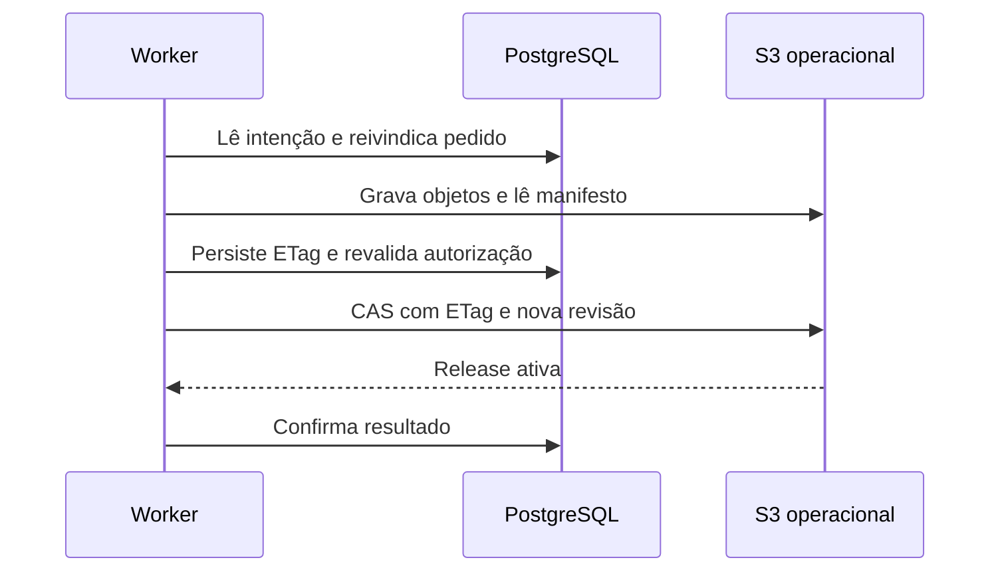
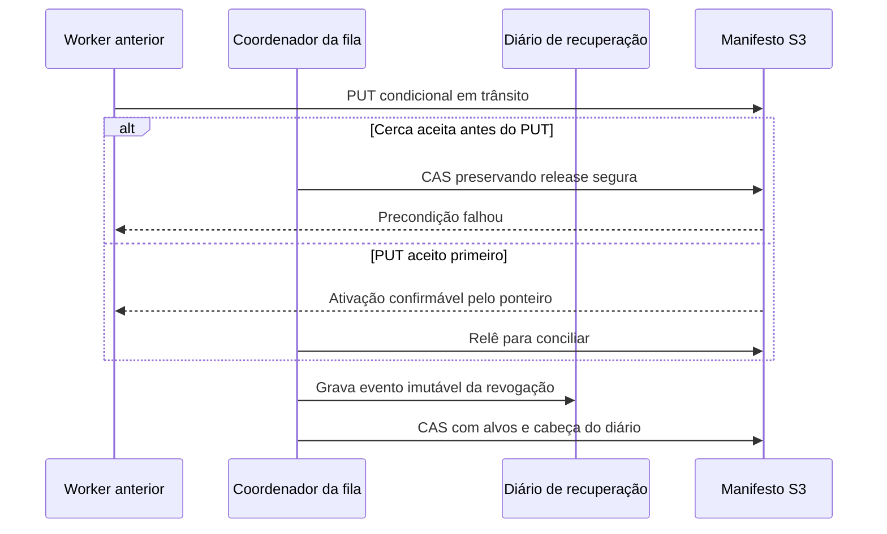
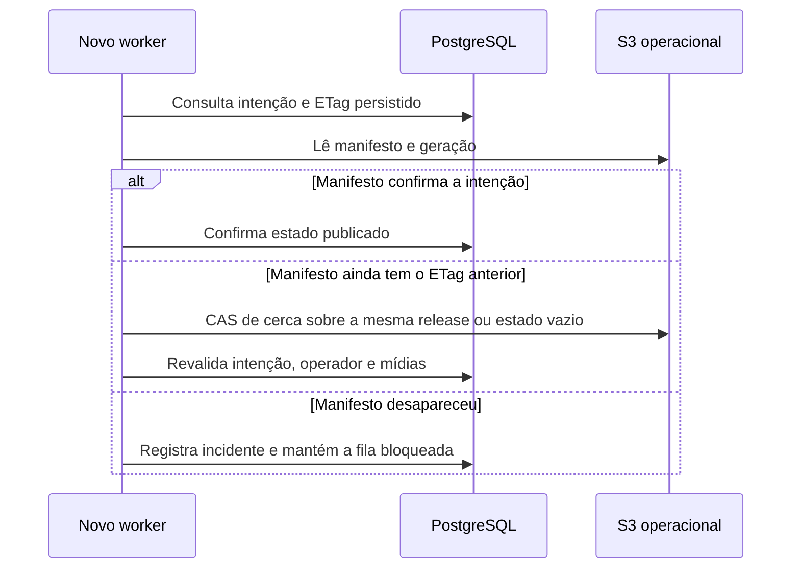

# MC Os Papas — Consistência distribuída e recuperação segura

**Etapa 02G.1 · Prova de conceito local**

## Decisão

O PostgreSQL mantém contas, escopos, aprovações, intenção de publicação e estado operacional. O manifesto no S3 determina a release efetivamente ativa e a cabeça confirmada do diário de revogações. O consumidor consulta o S3 e continua funcionando quando CMS e PostgreSQL estão indisponíveis. Um evento de revogação é escrito no armazenamento de recuperação antes do CAS do manifesto. Só integra o histórico confirmado quando alcançável a partir da cabeça no manifesto. A atualização condicional do manifesto é o ponto de linearização da publicação e da revogação pública. As mudanças de autorização administrativa continuam valendo no commit do PostgreSQL. [Especificação](ADMIN_PROJECT_SPEC.md) · [Prova de publicação](ADMIN_POC_PUBLICATION_REPORT.md) · [Prova de segurança](ADMIN_POC_SECURITY_REPORT.md)

| Bloqueador da Etapa 02G | Classificação | Resultado |
| --- | --- | --- |
| Corrida entre autorização e barreira no S3 | Não resolvido | Os locks mantêm a ordem enquanto a sessão PostgreSQL existe. Após perda da sessão, a escrita já emitida ainda pode vencer a barreira mesmo após mudança de autorização. A barreira protege somente contra escritas com ETag anterior quando ela vence. |
| Primeira ativação incerta | Resolvido no escopo experimental | Um manifesto vazio recebe a primeira ativação via If-Match. Na retomada, a fila reconhece o resultado ativo ou invalida o ETag anterior sem expor uma release. A criação inicial usa intenção condicional e admite bloqueio para investigação. |
| Histórico independente de revogação | Parcialmente resolvido | Eventos cifrados independem de backup operacional. A restauração recupera alvos e se mantém em quarentena diante de ausência, divergência ou adulteração. AWS IAM, proteção contra regressão do manifesto, evidência independente de revogações confirmadas e histórico de contas ainda exigem solução. |

## Estados e invariantes

- **Manifesto.** Ausente → inicializado vazio → ativo. CAS com nova revisão e UUID pode trocar somente a geração, preservando a release ativa e o horário. Perder o manifesto após inicialização é incidente. Linhagem identifica a criação, revisão cresce a cada CAS do worker e sequência ordena os pedidos do PostgreSQL. A última geração está no corpo que determina o ETag, inclusive em troca que mantém a mesma release.
- **Publicação.** Pendente → processando → publicado ou falhou. A fila grava o ETag base antes da escrita. Resposta incerta mantém o trabalho em processamento. Se o manifesto confirma ID e sequência, o worker reconcilia. Caso a base ainda esteja vigente, o worker tenta cercá-la via CAS. Só então repete a autorização e a validação e pode emitir nova escrita. A fila mantém a revogação posterior atrás do trabalho incerto até confirmação ou invalidação.
- **Revogação.** Intenção em fila → evento imutável preparado → cabeça referenciada no CAS → confirmação no PostgreSQL. Eventos preparados sem CAS podem permanecer órfãos e ficam fora do histórico confirmado. O UUID da release identifica a operação. A sequência é monotônica na cadeia, inclusive quando a sequência inclui publicações comuns no intervalo. Nenhum rollback de conteúdo diminui o conjunto de alvos revogados.
- **Restauração.** A cópia fica em quarentena antes da verificação do diário. A análise cruza linhagem, sequência, revisão, âncora arquivada, hash, encadeamento e equivalência do conjunto de alvos. Uma verificação bem-sucedida registra todos os alvos no banco isolado e exige revisão. Sessões não são recuperadas, trabalhos históricos continuam suspensos e o manifesto restaurado fica fora do caminho servido. A ferramenta não oferece promoção.
- **Publicação segura.** O CAS aponta para objetos íntegros e completos, gravados com criação condicional. O gateway só serve referências das releases elegíveis. O manifesto inclui digest de cabeça e IDs públicos. As entradas cifradas do diário e o recibo técnico de inicialização não são expostos pelo gateway. CDN e cópias já entregues têm eficácia distinta da revogação na origem.

## Inicialização

A rotina administrativa usa If-None-Match: * no recibo imutável por ambiente e, apenas para a execução que obteve a criação, no manifesto inicial. O manifesto vazio tem revisão zero, linhagem UUID e nenhuma release pública. Uma segunda execução observa a publicação da primeira ou encontra recibo sem manifesto e retorna incidente. Se a resposta da escrita do manifesto for perdida, a rotina relê o objeto. Se somente o recibo existir e a escrita do manifesto não puder ser confirmada, o ambiente permanece indisponível para novas ativações. O worker nunca recria o manifesto. Manifestos legados continuam legíveis publicamente, mas a ativação exige migração controlada de linhagem, revisão e histórico. Não execute bootstrap em um ambiente legado com perda de manifesto.

## Ordem de autorização e ativação

O teste fez uma escrita válida vencer antes de uma revogação pública posterior e verificou o caso inverso, com perda efetiva da sessão e o novo ETag invalidando o PUT atrasado. A corrida residual segue da ordem permitida pelos serviços. Um worker valida a permissão e emite o PUT com ETag E. A sessão é perdida e libera o lock. A desativação pode confirmar no PostgreSQL. Se o PUT chega ao S3 antes de outro CAS, E ainda vale e o S3 aceita a primeira escrita. O PostgreSQL e o S3 não compartilham transação. Leases, retries e timeouts não removem esse intervalo.

Para fechar o intervalo sem enfraquecer a semântica, uma mudança conflitante precisa persistir uma intenção antes das operações externas, cercar o manifesto antes de atualizar a autorização e manter a cerca até confirmar o resultado do banco. Enquanto a cerca persistir, nenhum worker pode preparar uma nova ativação com aquele token. Uma escrita antiga que vence antes da cerca lineariza antes da mudança administrativa. Se a cerca vence, o PUT antigo falha. Se o banco desfaz a operação ou perde resposta, a cerca continua até comprovação durável de commit ou abort e reconciliação da geração. Com atendimento de devolução síncrona, a mudança de permissões pode permanecer pendente se a cerca ou sua confirmação estiver indisponível. A decisão sobre essa disponibilidade exige aprovação.

Esse protocolo de mutação pré-commit precisa cobrir desativação de conta, alteração de perfil e lotação, desativação de unidade, transferência de membro, retirada de aprovação de mídia e revogação pública. REST, Local API, rotas de lote, workers e papéis SQL precisam obedecer à mesma autoridade. A PoC mantém as verificações e os locks aprovados da Etapa 02G nesses caminhos e não liga as mutações administrativas à cerca. O diário cobre revogações públicas de conteúdo e mídia. Alterações de conta e autorização exigem revisão manual quando se recupera uma cópia. A produção segue bloqueada até demonstrar o protocolo completo e impedir escritas e mutações alternativas pelo controle de acesso.

### Publicação normal

### Revogação concorrente

### Retomada após resultado incerto

## Diário e procedimento de recuperação

O diário usa um prefixo próprio no bucket de recuperação já previsto na Etapa 02G, fora dos buckets operacionais e das cópias de banco. As entradas têm ambiente, linhagem, UUID, sequência, alvo público e hash anterior. SHA-256 endereça a entrada e AES-256-GCM autentica seus bytes, vinculados ao bucket e à chave. A gravação condicional aceita duplicata só depois de verificar os bytes. O conjunto de revogados no manifesto continua servindo o bloqueio sem o consumidor ler a trilha privada. A verificação local usa credenciais distintas da mídia operacional. A separação real de permissão entre diário e backups depende de IAM por prefixo ou destino próprio. Quem controla os objetos do manifesto ainda pode tentar repor um ponteiro antigo com uma cadeia íntegra. A produção precisa de políticas de escrita condicional e negação de exclusão, versão protegida ou testemunha independente de cabeça confirmada, trilha resistente a alteração e um procedimento para comparar gerações. Avaliar Versioning, Object Lock, políticas de retenção e chaves separadas. [Escritas condicionais do S3](https://docs.aws.amazon.com/AmazonS3/latest/userguide/conditional-writes.html) · [Políticas para escritas condicionais](https://docs.aws.amazon.com/AmazonS3/latest/userguide/conditional-writes-enforce.html) · [Object Lock](https://docs.aws.amazon.com/AmazonS3/latest/userguide/object-lock.html)

1. Prepare bancos e destinos descartáveis conforme o roteiro 02G. Use o bucket de recuperação local preexistente para o diário. Em destinos novos, execute a preparação de publicação para criar o manifesto inicial em modo condicional.
2. Capture o backup da origem reconciliada, com os escritores pausados. Restaure em banco vazio de outro principal, no mesmo ambiente, seguindo o comando da Etapa 02G.
3. O restaurador mantém a quarentena ao cruzar a cópia com a origem, lê a cadeia e registra os alvos em poc_recovery_revocations. Ele confere o ETag da origem ao fim da cópia. Se a origem muda ou se o histórico falta, fica inválido ou inacessível, pare a análise e conserve a quarentena. O consumidor continua no manifesto de origem.
4. A eventual promoção exige fonte de revogações vigente e independente, revisão de privilégios, novas credenciais, preservação das revogações no snapshot candidato e nova sequência superior à origem. A PoC só verifica histórico e registra os alvos. Ela não libera a aplicação nem a fila restaurada.

## Matriz de falhas

| Falha | Comportamento | Evidência |
| --- | --- | --- |
| Inicializadores concorrentes e resposta do manifesto inicial perdida | Recibo reserva a criação, resposta perdida consultada por leitura | Validado no Moto |
| Manifesto iniciado excluído | Inicializador e worker recusam recriação | Validado em fixture local |
| Primeira ativação atrasada e PostgreSQL desconectado | A cerca sobre o manifesto vazio invalida o PUT; uma revalidação pode recusar operador | PostgreSQL real e atraso injetado no cliente S3 |
| Ativação vencedora e resultado perdido | Reconciliação confirma ID e sequência sem trocar novamente | Resposta omitida em cliente S3 e sucesso verificado no Moto |
| Revogação preparada e trabalho interrompido | Entrada imutável sem vínculo permanece fora do histórico; repetição reutiliza a entrada | Validado com estado do Moto e fila PostgreSQL |
| Diário removido, adulterado ou de outro ambiente | Histórico rejeitado e destino fica em quarentena | Validado com restauração local e falhas em fixture |
| PUT chega entre commit de permissão e cerca | Escrita anterior ainda pode vencer | Limitação do protocolo, bloqueador de produção |
| Cerca pré-commit de mutação com resultado SQL incerto | Exige resolução persistida antes de liberar ativações | Protocolo proposto, ainda não validado |

## Resultados e custo

O ensaio usou Debian 13 no Codex Cloud, Node.js 24.22.3, PostgreSQL 17.12 e Moto 5.2.6 em loopback. npm ci, TypeScript, lint, build de produção e inicialização standalone em /healthz passaram. Passaram **59 testes preexistentes** em acesso (15), mídia (15), publicação (17) e segurança (12), além de **6 testes novos** de consistência. A interrupção de sessão ocorreu no PostgreSQL real. Perda de resposta, atraso de escrita e remoção de objetos foram injetados em um ambiente local controlado.

| Medição | Resultado observado |
| --- | --- |
| Primeira tentativa atrasada com interrupção e cerca vencedora | 425 ms no trecho medido, incluindo perda da sessão, desativação da conta e invalidação da escrita antiga |
| Revogação com uma entrada anterior | 106 ms no worker, 14 operações no armazenamento operacional e 2 no diário |
| Crescimento do diário | 307 B em JSON para o evento de mídia, mais 28 B de nonce e tag |
| Backup de banco e 16 objetos | 432 ms, com dump comprimido de 90.905 B |
| Recuperação de 16 objetos e duas revogações posteriores | 542 ms no total, com 111 ms de pg_restore e 283 ms de reconciliação e cópia |
| Memória observada | 309.740 KiB de RSS no ensaio do diário e 318.668 KiB na restauração, incluindo Payload e fixtures |

Para repetir a suíte nova, prepare um banco DEV descartável, um banco vazio de outro principal em POC_RECOVERY_JOURNAL_TEST_URL e os destinos locais de recuperação. Use prefixo exclusivo de publicação, com os objetos de bootstrap ainda ausentes. Execute npm run test:consistency depois do build standalone. A suíte de segurança restaura também uma cópia anterior à revogação de um evento e de uma mídia real do fixture, verifica os dois alvos na quarentena e consulta o consumidor enquanto o CMS está parado.

O orçamento total segue em **R$ 50,00/mês**. O custo adicional autorizado e incorrido nesta etapa foi **R$ 0,00**. Pelo caminho normal, a leitura de manifesto substitui a leitura anterior e o CAS usa a mesma escrita. O worker atual não acrescenta consulta PostgreSQL à ativação normal. Cada revogação lê a cadeia anterior e grava uma entrada nova. Verificação linear em cadeias crescentes pode ser cara e segurar a fila. Planejar checkpoints autenticados, retenção e expiração de eventos órfãos apenas após política aprovada e verificação de alcançabilidade. A retenção deve evitar dados de conta e minimizar identificadores de conteúdo. Considerar armazenamento, requisições, verificação, IAM, histórico protegido e custos de HML e PRD. O desenho usa PostgreSQL e S3 existentes e não exige polling contínuo ou serviço adicional para este ensaio. Se a ordenação forte exigir um coordenador externo, comparar primeiro uma autoridade única com as alternativas apenas PostgreSQL/S3, incluindo custo de chamadas, operação, disponibilidade e escalonamento.

**Prosseguir com ajustes.** Homologar CAS e consistência com S3 real em ambiente autorizado, concorrência e paralisação antes/depois de cada escrita, perda de sessão e resultado de mutação SQL, política de exclusão e versões, migração de manifestos legados, proteção de cabeça e segregação de IAM. Produção depende também do fechamento da corrida de autorização, de recuperação segura de revogações e privilégios quando a origem se perde e da invalidação da CDN. [Consistência do S3](https://aws.amazon.com/s3/consistency/) · [Locks PostgreSQL](https://www.postgresql.org/docs/17/explicit-locking.html) · [Invalidação no CloudFront](https://docs.aws.amazon.com/AmazonCloudFront/latest/DeveloperGuide/Invalidation.html)
