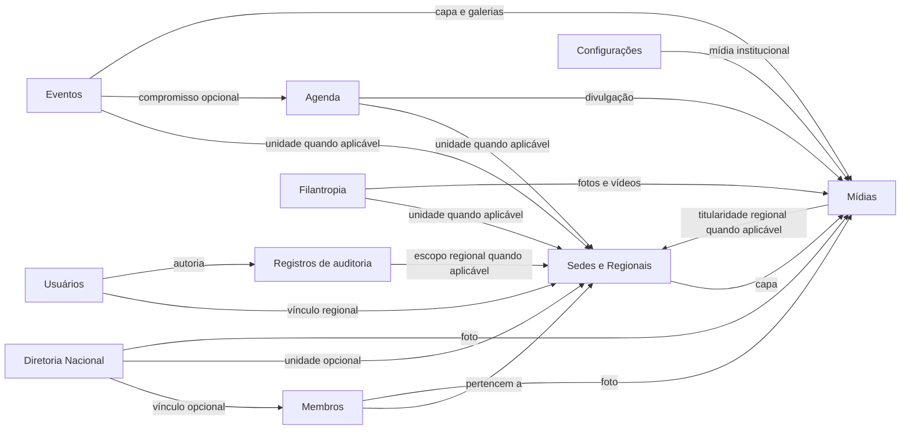

# MC Os Papas — Portal Administrativo

| Informação | Valor |
| --- | --- |
| Etapa | 01 — Requisitos e regras de negócio |
| Versão | 1.0 |
| Status | Requisitos aprovados |
| CMS selecionado | Payload CMS |
| Endereço administrativo proposto | `admin.mcospapas.com.br` |

## 1. Objetivo e diretrizes

Dar autonomia aos integrantes autorizados do MC Os Papas para manter o conteúdo do site institucional sem conhecimentos de programação e sem acesso a GitHub, Codex ou AWS. O portal deve centralizar a gestão de conteúdo, garantir segurança e isolamento regional, oferecer uma experiência acessível e responsiva e permitir auditoria e recuperação. A solução deve ser fácil de manter, ter baixo custo operacional e preservar o site institucional e sua identidade.

O Payload CMS substitui o Strapi como CMS selecionado para o portal. Os requisitos aprovados desta especificação prevalecem sobre as propostas administrativas anteriores. As referências históricas permanecem disponíveis. [PROJECT_SPEC.md](PROJECT_SPEC.md) · [STRAPI_CONTENT_MODEL.md](STRAPI_CONTENT_MODEL.md)

## 2. Decisões aprovadas

- Os perfis administrativos são Geral e Regional, com contas individuais e possibilidade de vários administradores para a mesma unidade.
- A publicação é explícita, após rascunho e prévia. Administradores regionais publicam diretamente dentro do seu escopo, sem aprovação central prévia.
- A desativação de conteúdo é reversível.
- A interface administrativa é escura e em português do Brasil.
- A agenda do MVP inclui compromissos destinados à divulgação pública. Publicações editoriais, notícias e comunicados ficam para etapas futuras.
- O MVP dispensa licenças comerciais obrigatórias de software e preserva o site institucional e sua identidade.

## 3. Perfis e matriz de permissões

O Administrador Geral tem escopo nacional, abrangendo todas as unidades. O Administrador Regional tem acesso administrativo limitado à unidade atribuída à sua conta. A matriz se aplica também às consultas, exportações e operações indiretas disponibilizadas pelo portal.

| Recurso ou operação | Administrador Geral | Administrador Regional |
| --- | --- | --- |
| Acessar o painel e consultar indicadores, próximos eventos, atividades, publicações e atalhos | Escopo nacional e todas as unidades | Unidade atribuída |
| Gerenciar a própria sessão e senha | Permitido | Permitido |
| Criar, desativar e reativar unidades ou alterar sua identidade e ordem de exibição | Todas as unidades | Vedado |
| Consultar registros administrativos de sedes e regionais | Todas as unidades | Unidade atribuída |
| Editar Sobre a Sede, WhatsApp, Instagram, endereço, link de localização e imagem de capa | Todas as unidades | Unidade atribuída, exclusivamente esses seis campos |
| Criar, editar, ordenar, desativar e reativar membros, inclusive trocar fotos | Todas as unidades | Unidade atribuída |
| Transferir membros ou alterar vínculos de titularidade regional | Permitido nas operações autorizadas | Vedado |
| Gerenciar a Diretoria Nacional, fotos, vínculos e ordenação | Permitido | Vedado, inclusive por alterações em registros relacionados |
| Gerenciar compromissos, eventos e destaques nacionais | Permitido | Vedado |
| Gerenciar compromissos, eventos e destaques regionais | Todas as unidades | Unidade atribuída, com destaque limitado ao contexto regional |
| Gerenciar ações de filantropia e seus destaques | Todas as ações | Vedado, inclusive em ações ligadas à unidade |
| Carregar, consultar, reutilizar e gerenciar fotos, vídeos, pôsteres e galerias | Escopo nacional e todas as unidades | Mídias e galerias autorizadas da unidade atribuída |
| Excluir mídia por operação autorizada | Sujeito à integridade das referências e às regras de retenção | Mesmas condições, no escopo da unidade atribuída |
| Gerenciar contas, perfis, atribuições e permissões | Permitido, sujeito à proteção do último Geral ativo | Vedado |
| Consultar auditoria e histórico | Escopo nacional e todas as unidades | Registros autorizados da unidade atribuída |
| Editar ou excluir registros de auditoria pelas operações ordinárias | Vedado | Vedado |
| Salvar rascunho, visualizar prévia, publicar, tentar novamente e despublicar | Conteúdo sob sua gestão | Conteúdo autorizado da unidade, sem aprovação prévia |
| Restaurar versões | Versões autorizadas em âmbito nacional e regional | Versões autorizadas da unidade, respeitando os campos permitidos |
| Gerenciar configurações globais | Permitido | Vedado |

O backend aplica a matriz a cada operação, registro e campo, incluindo APIs, relacionamentos, mídia, operações em lote, restauração e endpoints personalizados. Ocultar controles na interface complementa os controles do servidor.

## 4. Requisitos funcionais

### RF-01 — Autenticação

Autenticar por e-mail e senha em contas individuais provisionadas pelo Administrador Geral. Disponibilizar recuperação por e-mail, alteração de senha, gerenciamento seguro da sessão e encerramento da sessão. Restringir o acesso a contas ativas, revogar sessões na desativação e proteger contra tentativas abusivas de autenticação. O provisionamento é exclusivamente administrativo. A autenticação multifator é desejável.

### RF-02 — Painel administrativo

Exibir indicadores de conteúdo relevantes, próximos eventos, atividades administrativas recentes, situação das publicações e atalhos para operações autorizadas. Adaptar as informações ao perfil. Para o Regional, limitar os dados e indicadores agregados à unidade atribuída.

### RF-03 — Diretoria Nacional

**Campos.** Nome de exibição, cargo, ordem de exibição e situação ativo/inativo são obrigatórios. Patente, unidade regional e vínculo com um membro regional são opcionais. A fotografia é obrigatória para publicação.

**Operações.** Permitir ao Geral criar, editar, desativar e reativar diretores, substituir fotos, ordenar cartões com controles acessíveis e reaproveitar dados e fotos de um membro vinculado. Vários diretores podem exercer o mesmo cargo. A retirada da Diretoria preserva o cadastro regional do membro. Alterações regionais em membros ou mídias compartilhadas devem preservar os dados e a mídia publicados na Diretoria até uma ação autorizada do Geral.

### RF-04 — Sedes e Regionais

**Campos.** Nome, tipo de unidade, cidade, estado, descrição (Sobre a Sede), número do WhatsApp, Instagram, endereço, link de mapa ou localização, imagem de capa, ordem de exibição e situação ativo/inativo.

**Operações.** O Geral gerencia todos os campos e o ciclo de vida das unidades. O menu proposto **Minha Sede** reúne os seis campos que o Regional pode editar na unidade atribuída.

1. Sobre a Sede
2. Número do WhatsApp
3. Instagram
4. Endereço
5. Link da localização
6. Imagem de capa

Validar os dados de contato e as URLs externas e gerar automaticamente o link do WhatsApp a partir do número cadastrado. Preservar as URLs públicas existentes. Para desativar ou reativar uma unidade, aplicar o RN-07.

**Publicação e acervo.** Publicar uma unidade com página pública própria exige descrição (Sobre a Sede), imagem de capa e texto alternativo descritivo e não vazio, inclusive em Minha Sede. Permitir rascunhos incompletos. Subsedes Representativas sem página própria dispensam descrição e capa. Na migração, preservar as referências históricas existentes e encaminhar lacunas à revisão administrativa, sem inventar descrições ou imagens nem despublicar automaticamente.

### RF-05 — Membros

**Campos.** Nome de exibição ou apelido, patente, unidade regional, ordem de exibição e situação ativo/inativo são obrigatórios. Cargo ou função é opcional. A fotografia é obrigatória para publicação.

**Operações.** Criar, editar, substituir fotos, ordenar cartões manualmente, desativar e reativar membros. Transferências entre unidades são exclusivas do Geral. Tratar patente e cargo como campos distintos. Exemplo de exibição pública com nome Kátia, cargo Diretora e patente Cardeal: **Kátia — Diretora - Cardeal**. Dispensar informações pessoais desnecessárias, como CPF, RG e endereço residencial.

### RF-06 — Agenda

| Obrigatoriedade | Campos |
| --- | --- |
| Obrigatórios para publicação | Título, categoria, organizador e situação do compromisso. |
| Opcionais | Data final, horário, local, descrição, link externo ou de mapa, imagem de divulgação e indicação de destaque. |
| Obrigatórios sob condição | Unidade regional para compromissos regionais. Data inicial quando definida ou indicação explícita de data a definir enquanto estiver pendente. Para compromissos históricos com data incompleta, registrar a precisão conhecida, como mês e ano ou apenas o ano, e identificar a data como parcial. |

**Categorias iniciais.** Sede Aberta, Bate e Volta, Encontro Nacional, Encontro Motociclístico, Aniversário, Confraternização, Ação Social e Outros.

**Situações.** A confirmar, Confirmado, Adiado, Cancelado e Realizado.

**Operações.** Um compromisso regional publicado alimenta automaticamente a agenda da unidade e a página geral de Agenda a partir do mesmo registro. Permitir todos os meses e anos de forma dinâmica, períodos de vários dias e compromissos com data a definir. Permitir manter compromissos cancelados com sua situação visível quando pertinente. Apenas o Geral gerencia compromissos e destaques nacionais. O MVP contempla compromissos destinados ao público.

### RF-07 — Eventos

| Obrigatoriedade | Campos |
| --- | --- |
| Obrigatórios para publicação | Título, categoria, data ou período, descrição e imagem de capa. |
| Opcionais | Cidade, estado, galeria de fotos, galeria de vídeos, vínculo com um compromisso da Agenda e indicação de destaque. |
| Obrigatórios sob condição | Unidade responsável para eventos regionais. Texto alternativo para cada imagem publicada, conforme o RF-09. |

O rascunho pode ser salvo sem imagem de capa. Para eventos históricos com data incompleta, registrar apenas a precisão conhecida, como mês e ano ou apenas o ano.

**Operações.** Cadastrar eventos realizados de forma independente ou vinculada à Agenda. Reaproveitar informações do compromisso vinculado e evitar duplicação desnecessária. Um evento regional publicado alimenta automaticamente a página da unidade e a página geral de Eventos. Apenas o Geral gerencia eventos e destaques nacionais. Preservar eventos históricos, URLs, âncoras e galerias existentes.

### RF-08 — Filantropia

| Obrigatoriedade | Campos |
| --- | --- |
| Obrigatórios para publicação | Título da ação, cidade, estado, descrição e informação temporal registrada como data, período ou ano. |
| Opcionais | Instituição beneficiária, impacto social, quantidade de beneficiários, tipo de doação ou ação, fotos, vídeos e indicação de destaque. |
| Obrigatórios sob condição | Unidade regional quando houver unidade responsável. Autorização apropriada para a divulgação de cada mídia incluída na publicação. Texto alternativo para cada imagem publicada, conforme o RF-09. |

Para ações históricas com data incompleta, registrar apenas a precisão conhecida, como mês e ano ou apenas o ano.

**Operações.** A gestão de ações recentes e históricas é exclusiva do Geral. Registrar impacto social e quantidade de beneficiários somente quando houver informações confirmadas. Garantir autorização apropriada para a divulgação de mídias, especialmente as que envolvam crianças ou pessoas vulneráveis.

### RF-09 — Fotografias, vídeos e galerias

Permitir envio de vários arquivos, acompanhamento do progresso, prévia, busca, filtros, ordenação manual, reutilização autorizada e consulta a indicadores de uso de armazenamento. Otimizar imagens e vídeos preservando a proporção das imagens e a qualidade adequada. Gerar pôsteres de vídeo automaticamente e permitir a seleção manual de um pôster para cada vídeo. Exigir texto alternativo descritivo e não vazio para cada imagem na publicação, incluindo capas, fotografias e imagens de galerias, novas ou reutilizadas. Permitir o envio e o uso em rascunhos antes do preenchimento. O backend deve bloquear a publicação de conteúdo que inclua imagem sem texto alternativo.

Identificar o âmbito nacional ou a titularidade regional de cada mídia e proteger o acesso a mídias de rascunho. Validar o tipo real dos arquivos e os limites de envio. Impedir acesso regional a mídias restritas, alterações em mídias de outra unidade e exclusão de mídias referenciadas. Formatos aceitos, limites de tamanho, cotas, processamento, retenção e custos serão definidos na Etapa 02.

### RF-10 — Usuários administrativos

**Campos.** Nome, e-mail único, perfil, unidade atribuída quando aplicável, situação ativo/inativo, data e hora da criação, responsável pela criação e data e hora do último acesso.

**Operações.** O Geral autorizado cria contas individuais e administra perfis, permissões, atribuições e situação. Cadastro de membro e conta administrativa são independentes. A desativação da conta revoga as sessões ativas. Para Regionais vinculados a uma unidade desativada, aplicar também o RN-07. Bloquear a desativação e o rebaixamento do último Geral ativo, inclusive diante de operações simultâneas.

### RF-11 — Auditoria e histórico

Registrar as operações administrativas relevantes com usuário responsável, data e hora, operação, entidade e registro afetados, titularidade regional quando aplicável e valores anteriores e novos quando pertinentes. Incluir publicação e restauração. Proteger a trilha contra alterações ou exclusões ordinárias e excluir senhas, tokens e segredos dos registros. Restringir a consulta regional aos registros autorizados da unidade. Permitir restauração de conteúdo conforme a autorização vigente.

### RF-12 — Publicação de conteúdos

1. Criar ou editar o conteúdo.
2. Salvar como rascunho.
3. Visualizar a prévia.
4. Acionar explicitamente a publicação.
5. Validar conteúdo e autorização no backend.
6. Sincronizar automaticamente o conteúdo público.
7. Informar o estado e o resultado da publicação.

Manter rascunhos, prévias e mídias privadas fora do acesso público. Publicar conteúdo regional autorizado diretamente e atualizar o site sem operação manual no GitHub. Em caso de falha, manter a versão pública anterior e permitir nova tentativa. Detectar conflitos de edição concorrente e proteger contra sobrescrita acidental. Permitir despublicar e restaurar conteúdo sob autorização. Manter o site público disponível durante indisponibilidade do portal. A Etapa 02 definirá a infraestrutura e o mecanismo de sincronização.

## 5. Catálogo de regras de negócio

| ID | Regra | Origem |
| --- | --- | --- |
| RN-01 | Toda ação administrativa exige uma conta individual ativa. O cadastro de membro é independente. Somente o Geral autorizado provisiona contas e modifica permissões. O e-mail é único e o cadastro público é vedado. | RF-01, RF-10 |
| RN-02 | Cada Regional é vinculado a uma unidade. A unidade pode ter vários administradores, cada qual com conta e sessões próprias. | RF-01, RF-10 |
| RN-03 | O backend valida perfil, titularidade, registro, ação e campos em todas as operações. Inclui listagens, indicadores, relacionamentos, mídia, versões, APIs, operações em lote e endpoints personalizados. O Regional só acessa registros administrativos autorizados da unidade atribuída. | RF-02 a RF-12 |
| RN-04 | O Regional pode editar somente os seis campos de Minha Sede. Identidade, ordenação, situação da unidade, atribuições administrativas e titularidade regional só podem mudar em operações autorizadas ao Geral. | RF-04, RF-05, RF-10 |
| RN-05 | A autorização também vale para os efeitos indiretos. Vínculos, substituições de mídia e alterações em fontes reutilizadas devem preservar o conteúdo nacional e de outras unidades contra alterações regionais. O reaproveitamento pela Diretoria requer ação autorizada do Geral. | RF-03, RF-07, RF-09 |
| RN-06 | O Geral administra a Diretoria, as unidades, a filantropia, as contas e permissões e as configurações globais. Agenda, eventos e destaques nacionais são exclusivos do Geral. O Regional administra membros, compromissos, eventos, destaques locais e galerias autorizadas de sua unidade. | Matriz, RF-03 a RF-10 |
| RN-07 | A desativação de diretores, unidades e membros é reversível. A desativação efetiva de uma unidade bloqueia o login e o acesso administrativo dos Regionais vinculados, revoga as sessões existentes e impede operações sem autorização vigente. Preserva contas, sua situação individual, conteúdos, autoria e histórico. Revalidar operações pendentes conforme Security First e o protocolo de consistência distribuída. Após reativar a unidade, somente contas ainda habilitadas e autorizadas podem entrar por novo login. Sessões revogadas permanecem inválidas. A retirada de um diretor preserva o cadastro regional do membro vinculado. | RF-03, RF-04, RF-05 |
| RN-08 | A ordenação manual determina a apresentação de cartões e galerias em seu contexto. Os controles de ordenação de diretores e membros devem ser acessíveis. | RF-03, RF-04, RF-05, RF-09 |
| RN-09 | Vários diretores podem ocupar o mesmo cargo. Para diretores e membros, a publicação exige foto e os campos obrigatórios. Patente e cargo são informações distintas. | RF-03, RF-05 |
| RN-10 | As mudanças de unidade de um membro exigem operação explícita do Geral e devem preservar seu histórico. O Regional fica impedido de alterar titularidade ou associações para obter acesso indevido. | RF-05, RF-11 |
| RN-11 | O contato público usa dados validados. O link do WhatsApp é gerado a partir do número. URLs externas são validadas e URLs públicas existentes são preservadas. | RF-04 |
| RN-12 | Cada compromisso ou evento regional tem um registro de origem que alimenta as páginas regionais e gerais. Eventos realizados podem existir independentemente da Agenda ou reaproveitar dados do compromisso vinculado. A publicação de eventos exige imagem de capa com texto alternativo. Galerias e vínculo com a Agenda são opcionais. | RF-06, RF-07, RF-09 |
| RN-13 | A Agenda contempla compromissos públicos, inclusive de vários dias e com indicação explícita de data a definir. Compromissos históricos, eventos realizados e ações históricas de filantropia preservam a precisão da data disponível, sem preenchimento de partes desconhecidas. O cancelamento de um compromisso pode permanecer visível com a situação correta. | RF-06, RF-07, RF-08 |
| RN-14 | O portal coleta somente dados pessoais necessários. Impacto social e quantidade de beneficiários são opcionais e só podem ser registrados com base em informações confirmadas. A divulgação pública de mídias deve contar com autorização apropriada, com atenção especial a crianças e pessoas vulneráveis. | RF-05, RF-08, RNF-03 |
| RN-15 | A mídia tem titularidade definida e seu acesso respeita a autorização e a situação da publicação. O portal valida tipo real e limites dos arquivos e exige texto alternativo descritivo e não vazio em toda imagem publicada, inclusive imagens reutilizadas. Rascunhos podem conter imagens com texto alternativo pendente. A exclusão fica bloqueada enquanto houver referência ativa, em rascunho ou necessária à restauração de uma versão retida. | RF-09, RF-11, RF-12 |
| RN-16 | O Geral autorizado administra a situação das contas. A desativação revoga as sessões ativas e o sistema mantém pelo menos um Geral ativo, inclusive sob concorrência. | RF-01, RF-10 |
| RN-17 | A auditoria preserva autoria, contexto regional, operação, data e mudanças pertinentes. Operações administrativas ordinárias são incapazes de editar ou apagar registros. Senhas, tokens e segredos ficam fora da trilha. | RF-11 |
| RN-18 | Toda publicação exige ação explícita após rascunho e prévia, com validação no backend. Validar os campos obrigatórios e condicionais de unidades com página própria (RF-04), Agenda (RF-06), Eventos (RF-07) e Filantropia (RF-08). Exigir unidade responsável em compromissos e eventos regionais e nas ações de filantropia com responsabilidade regional. O Regional publica diretamente dentro de seu escopo. Rascunhos, prévias e mídia privada permanecem acessíveis apenas a pessoas autorizadas. | RF-04, RF-06 a RF-09, RF-12 |
| RN-19 | A sincronização pública é automática. Uma falha preserva a versão pública anterior, informa o estado e permite nova tentativa. Conflitos concorrentes devem ser identificados antes de sobrescrever mudanças. | RF-12 |
| RN-20 | Restaurar ou despublicar exige autorização vigente, validação de campos, relacionamentos e mídias e registro de auditoria. O conteúdo restaurado deve passar pelo fluxo de publicação antes de substituir a versão pública. | RF-11, RF-12 |
| RN-21 | O site público continua a servir o conteúdo publicado durante indisponibilidade administrativa. A migração preserva o conteúdo histórico, URLs, âncoras, galerias e elementos de SEO existentes. | RF-04, RF-07, RF-12, RNF-06, RNF-12 |
| RN-22 | Obrigações de retenção ou privacidade que exijam exclusão permanente devem seguir um procedimento controlado a ser definido separadamente. | RF-09, RF-11, RNF-03 |

## 6. Modelo conceitual de dados

| Entidade | Responsabilidade e relações |
| --- | --- |
| Usuários | Representam contas administrativas. Uma conta Regional pertence a uma unidade. A mesma unidade pode ter várias contas Regionais. Usuários são autores das operações de auditoria. |
| Sedes e Regionais | Representam unidades, sua identidade, localização, contatos, capa e situação. Reúnem membros e registros regionais. Ações de filantropia também podem indicar uma unidade responsável. |
| Membros | Representam integrantes de uma unidade, com patente, cargo opcional, fotografia, ordem e situação. Podem ser vinculados a registros da Diretoria. |
| Diretoria Nacional | Representa os diretores, seus cargos, fotos, ordem e situação. Cada registro pode indicar uma unidade e um membro, respeitando o controle nacional do conteúdo. |
| Agenda | Reúne compromissos públicos nacionais e regionais. Pode fornecer dados para eventos realizados. |
| Eventos | Reúne registros de eventos realizados, nacionais ou regionais, com capa e galerias. Cada registro pode se vincular a um compromisso. |
| Filantropia | Reúne ações recentes e históricas, mídias e informações confirmadas sobre beneficiários e impacto, com unidade responsável quando aplicável. |
| Mídias | Representam fotos, vídeos e pôsteres de âmbito nacional ou regional. Podem ser usados como capas, fotos, imagens de divulgação ou itens ordenáveis de galerias. |
| Registros de auditoria | Registram autoria, operação, referência à entidade e ao registro afetado, escopo regional quando aplicável e mudanças pertinentes. |
| Configurações | Reúnem parâmetros globais administrados pelo Geral e podem referenciar mídias de uso institucional. |

A Etapa 02 definirá o esquema físico, as coleções do Payload CMS e a estratégia de migração.

### Compatibilidade com o site institucional

| Estrutura existente | Requisito para a migração |
| --- | --- |
| Diretoria e listas de membros em `web/data/leadership.ts` e `web/data/sedes/` | Preservar fotos, nomes, cargos, patentes e ordem. Conferir dados reaproveitados para manter a autonomia da Diretoria Nacional. |
| Sedes e representações em `web/data/sedes/`, com páginas por identificador em `/sedes/[slug]` | Preservar identificadores de URL, identidade das unidades, variações de apresentação, contatos, coordenadas exibidas no mapa, imagens e referências de navegação. |
| Agenda geral e conteúdos de Sede Aberta em `web/app/agenda/` e `web/data/sedes/` | Inventariar compromissos existentes, preservar âncoras públicas e consolidar registros equivalentes que alimentam mais de uma página. |
| Eventos regionais em `web/data/sedes/` e páginas em `web/app/eventos/` | Preservar registros históricos, incluindo o Encontro Nacional, URLs, âncoras, fotos, vídeos, pôsteres e ordem de exibição. |
| Ações recentes e históricas em `web/app/filantropia/` | Preservar períodos, descrições, âncoras, fotos, vídeos e pôsteres. Manter sem preenchimento os dados opcionais sem fonte confirmada. |
| Mídias em `web/public/`, metadados das páginas e exportação estática do site | Inventariar referências públicas, preservar elementos de SEO e garantir continuidade de navegação e acesso a mídias após a migração. |

## 7. Requisitos não funcionais

| ID | Requisito |
| --- | --- |
| RNF-01 | **Administração responsiva.** Permitir os fluxos administrativos em desktop, tablet e celular, com navegação, formulários, prévias e ações utilizáveis. |
| RNF-02 | **Segurança e autorização no backend.** Aplicar controles por perfil, unidade, registro, campo e operação, inclusive em acessos diretos e indiretos. Proteger credenciais e sessões. |
| RNF-03 | **Privacidade e LGPD.** Minimizar dados, restringir acesso conforme finalidade e tratar divulgação, retenção e exclusão observando as obrigações aplicáveis. |
| RNF-04 | **Acessibilidade.** Adotar WCAG 2.2 nível AA como meta para os fluxos administrativos, incluindo navegação por teclado, foco, contraste, formulários, avisos e reordenação. |
| RNF-05 | **Desempenho e otimização de mídia.** Otimizar carregamento e processamento de imagens e vídeos, com preservação de proporção e qualidade adequada. A Etapa 02 definirá metas e método de avaliação. |
| RNF-06 | **Disponibilidade do site público.** Manter acessíveis as páginas e as mídias publicadas durante indisponibilidade do portal. |
| RNF-07 | **Backups automatizados e restauração testada.** Cobrir dados e mídias e verificar a recuperação e a integridade das referências em testes de restauração. |
| RNF-08 | **Manutenibilidade e qualidade de código.** Adotar padrões verificáveis de código, documentar decisões e procedimentos essenciais e permitir manutenção segura dos módulos. |
| RNF-09 | **Localização em português do Brasil.** Apresentar navegação, formulários, validação, mensagens e formatos de data e hora de acordo com a localização. |
| RNF-10 | **Baixo custo operacional.** Manter infraestrutura e operação dentro do orçamento a ser aprovado na Etapa 02, considerando os custos recorrentes da solução. |
| RNF-11 | **Observabilidade e monitoramento de erros.** Permitir detectar e diagnosticar falhas administrativas, de publicação e de processamento de mídia, preservando a privacidade. |
| RNF-12 | **Preservação do conteúdo, URLs e SEO.** Conservar conteúdo publicado, identidade institucional, URLs, âncoras, galerias e metadados relevantes para indexação. |
| RNF-13 | **Testes automatizados de fluxos críticos.** Cobrir autenticação, autorização regional e por campo, mídia privada, publicação, conflitos, auditoria e restauração. |
| RNF-14 | **Sem licença comercial obrigatória.** Selecionar componentes que permitam operar o MVP sem obrigatoriedade de licença comercial de software. |
| RNF-15 | **Portabilidade.** Permitir exportar dados e mídias com informações suficientes para reconstruir vínculos e interpretar os registros fora da instalação de origem. |

A Etapa 02 definirá o domínio e a infraestrutura, o orçamento, os limites e as cotas de mídia, a estratégia de processamento e sincronização, as metas de desempenho e os períodos e procedimentos operacionais de retenção e recuperação.

## 8. Escopo do MVP

| Incluído | Adiado |
| --- | --- |
| Autenticação e painel administrativo | Publicações editoriais e notícias |
| Diretoria Nacional | Comunicados e comunicações |
| Sedes, regionais e membros | Portal privado de membros |
| Agenda pública e eventos | Compromissos privados de agenda |
| Filantropia e gestão de mídias | Gestão financeira e mensalidades |
| Usuários administrativos e permissões | Inscrição em eventos |
| Auditoria e histórico | Gestão dedicada de viagens |
| Publicação automatizada | Notificações por push |
| Migração do conteúdo existente | Integrações com redes sociais e aplicativos administrativos nativos |

## 9. Diretrizes de experiência e interface

- Aplicar uma interface escura em português do Brasil, alinhada à identidade do MC Os Papas.
- Adaptar navegação e formulários a desktop, tablet e celular. Garantir acesso por teclado, rótulos claros, foco visível e controles acessíveis.
- Apresentar menus e atalhos de acordo com as operações autorizadas a cada perfil. Reunir os seis campos editáveis da unidade no menu proposto **Minha Sede**.
- Oferecer fluxos simples de criação, edição e publicação, com prévia, mensagens claras de validação e erro, indicadores de carregamento e progresso e confirmação nas operações sensíveis.

O Design System detalhado, incluindo cores, tipografia, componentes e protótipos, será definido na Etapa 03.

## 10. Critérios de aceite

Executar os cenários com dados de teste, dois usuários regionais atribuídos à mesma unidade, outro Regional de unidade distinta, um Geral e um visitante sem sessão. Usar versões públicas e rascunhos com mídias distintas. Nos testes de autorização, verificar a resposta e a ausência de alterações indevidas, inclusive em registros relacionados. Os parâmetros operacionais aprovados na Etapa 02 serão usados nos cenários que dependem deles.

### Critérios funcionais

| ID | Requisito | Cenário | Resultado esperado |
| --- | --- | --- | --- |
| CA-RF-01.1 | RF-01 | Entrar com e-mail e senha de uma conta ativa, recuperar a senha pelo e-mail, alterar a senha e sair. | Os fluxos terminam com sucesso e uma solicitação autenticada com a sessão encerrada é rejeitada. |
| CA-RF-01.2 | RF-01 | Tentar autenticar uma conta inativa, simular tentativas abusivas e buscar cadastro anônimo pela interface e pela API. | A conta inativa é recusada, a proteção contra abuso é aplicada e o visitante é impedido de criar uma conta. |
| CA-RF-02.1 | RF-02 | Abrir o painel com o Geral e com Regionais de unidades diferentes que tenham compromissos, atividades e publicações diferentes. | O Geral tem visibilidade nacional e acesso às configurações globais. Cada Regional recebe apenas os indicadores, próximos eventos, atividades, estados de publicação e atalhos autorizados de sua unidade. |
| CA-RF-03.1 | RF-03 | Como Geral, criar dois diretores com o mesmo cargo, vincular um membro, editar registros, substituir fotos e reordenar cartões por teclado. Tentar publicar um diretor sem foto. | O cargo repetido e o reaproveitamento autorizado funcionam, o site reflete a ordem publicada e a publicação sem foto é bloqueada. |
| CA-RF-03.2 | RF-03 | Desativar e reativar um diretor vinculado. Como Regional, modificar dados autorizados do membro e tentar substituir ou alterar a foto usada pela Diretoria. | O cadastro regional permanece íntegro e a Diretoria só muda por ação autorizada do Geral. |
| CA-RF-04.1 | RF-04 | Como Geral, criar uma unidade, editar todos os campos em unidades distintas e alterar a ordem. Desativar uma unidade com Regionais habilitados, uma conta regional inativa, sessões abertas, uma operação pendente, membros e eventos. Tentar novo login e operações diretas pela API com as sessões existentes. Reativar a unidade e testar sessões antigas e novo login. Salvar rascunho de unidade com página própria e tentar publicar com descrição, capa ou alt descritivo e não vazio ausentes. Publicar uma Subsede Representativa sem página própria, descrição ou capa. Migrar um registro histórico com lacuna. | A gestão abrange todas as unidades. A inativação bloqueia login e operações regionais, revoga as sessões e exige revalidar operações pendentes pelo protocolo de consistência, impedindo efeitos sem autorização vigente. Contas, situação individual, conteúdos, autoria, histórico e URLs são preservados. A reativação aceita novo login apenas de contas habilitadas e autorizadas, e as sessões revogadas seguem inválidas. O rascunho é salvo, a publicação incompleta com página própria é recusada e a representação pode ser publicada. A migração preserva referências históricas e encaminha lacunas à revisão administrativa sem inventar dados ou despublicar automaticamente. |
| CA-RF-04.2 | RF-04 | Como Regional, salvar um rascunho incompleto em Minha Sede para unidade com página própria. Testar publicação sem descrição, sem capa e com alt ausente, vazio, composto só de espaços ou não descritivo. Corrigir as pendências e publicar mudanças nos seis campos. Enviar também um contato inválido, uma URL inválida, mudanças de nome, tipo, cidade, estado, ordem e status e alteração em outra unidade pela API. | O rascunho incompleto é salvo. A publicação exige descrição, capa e alt descritivo e não vazio. Os seis campos válidos são publicados na unidade atribuída, com link de WhatsApp gerado corretamente. Contatos inválidos, campos fora do escopo e acesso a outra unidade são rejeitados. |
| CA-RF-05.1 | RF-05 | Criar e editar membro, substituir a foto, reordenar cartões por teclado, desativar e reativar o membro. Tentar publicar sem foto ou patente. | O cadastro dispensa CPF, RG e endereço residencial. Cargo e patente ficam separados, a publicação incompleta é rejeitada e as alterações válidas refletem a ordem e a situação no site. |
| CA-RF-05.2 | RF-05 | Tentar transferir membro ou alterar a unidade do cadastro como Regional. Executar a transferência como Geral. | A tentativa regional é rejeitada e a transferência autorizada atualiza a unidade preservando o cadastro e seu histórico. |
| CA-RF-06.1 | RF-06 | Publicar compromissos regionais em meses e anos diferentes, incluindo período de vários dias, data a definir e compromisso cancelado mantido para consulta. | As visões regional e geral exibem os mesmos registros, sem duplicidade, com período, data a definir e situação correspondentes. |
| CA-RF-06.2 | RF-06 | Usar cada categoria e situação inicial, preencher os campos opcionais e tentar alterar um compromisso ou destaque nacional como Regional. | As categorias e situações aprovadas são aceitas, os campos opcionais podem ser omitidos e as alterações nacionais são exclusivas do Geral. |
| CA-RF-06.3 | RF-06 | Tentar publicar sem cada campo obrigatório, sem unidade regional em compromisso regional ou sem nenhuma informação de data. Publicar um compromisso com data a definir e um registro histórico com mês e ano, ambos sem os campos opcionais. | As tentativas incompletas são rejeitadas. O compromisso pendente exibe a indicação de data a definir e o registro histórico preserva o mês e o ano informados. |
| CA-RF-07.1 | RF-07 | Cadastrar um evento regional realizado com fotos e vídeos e outro com vínculo a um compromisso. Publicar ambos com capa e texto alternativo em todas as imagens e tentar configurar destaque nacional como Regional. | O cadastro independente e o reaproveitamento de dados funcionam. Cada registro regional aparece na página da unidade e na página geral. O destaque nacional exige perfil Geral. |
| CA-RF-07.2 | RF-07 | Salvar um rascunho sem capa e tentar publicá-lo. Repetir a tentativa com capa sem texto alternativo, sem data ou período, com outro campo obrigatório ausente ou sem unidade responsável em um evento regional. Preencher os campos exigidos e publicar um evento histórico com apenas o ano conhecido, sem informar cidade, estado, galerias ou vínculo com a Agenda. | O rascunho é salvo. A publicação é bloqueada enquanto faltar capa, texto alternativo ou outro dado exigido. Com os campos exigidos preenchidos, o evento é publicado com o ano informado e sem cidade ou estado. |
| CA-RF-08.1 | RF-08 | Como Geral, cadastrar uma ação recente e outra histórica, associar a unidade responsável, incluir fotos com texto alternativo e vídeos autorizados, informar apenas o ano quando pertinente e deixar impacto e beneficiários em branco. Tentar acessar a gestão como Regional. | Os registros e mídias são aceitos, números ausentes permanecem em branco e a gestão regional é rejeitada. |
| CA-RF-08.2 | RF-08 | Tentar publicar uma ação com um campo obrigatório ausente, com responsabilidade regional sem a unidade registrada ou com mídia sem autorização de divulgação. Publicar uma ação histórica nacional com apenas o ano conhecido, sem mídia, instituição, impacto, quantidade de beneficiários, tipo de doação ou destaque. | O sistema bloqueia as tentativas incompletas e aceita a ação histórica com os campos opcionais vazios e o ano na precisão informada. |
| CA-RF-09.1 | RF-09 | Enviar imagens e vídeos juntos, observar progresso e prévias, buscar e filtrar arquivos, aplicar texto alternativo, alterar a ordem e selecionar pôster distinto para dois vídeos. | A interface informa uso do armazenamento, as mídias são otimizadas com proporção de imagens preservada, os pôsteres automáticos são gerados e cada pôster manual é aplicado ao vídeo correspondente. |
| CA-RF-09.2 | RF-09 | Enviar arquivo com tipo real inválido ou acima do limite. Tentar acessar mídia privada de outra unidade, alterar seu vínculo ou excluí-la em lote. Reutilizar mídia autorizada e tentar apagar arquivo referenciado. | Envios inválidos e operações regionais indevidas são rejeitados. A reutilização autorizada funciona e as referências impedem a exclusão. |
| CA-RF-09.3 | RF-09 | Salvar rascunhos com imagens novas ou reutilizadas cujo texto alternativo esteja ausente, vazio ou preenchido apenas com espaços. Tentar publicar as imagens em uma capa e em uma galeria. Preencher textos alternativos descritivos e tentar novamente. | O rascunho é salvo. O backend bloqueia a publicação enquanto houver imagem sem texto alternativo válido. Após a correção, a publicação é aceita e o site apresenta os textos alternativos. |
| CA-RF-10.1 | RF-10 | Cadastrar dois administradores Regionais na mesma unidade, tentar repetir um e-mail e atribuir permissões como Regional. Consultar os metadados após o primeiro acesso. | Cada conta opera individualmente no mesmo escopo. E-mail duplicado e alteração de permissões por Regional são rejeitados. Criação, criador e último acesso constam no registro. |
| CA-RF-10.2 | RF-10 | Usar uma sessão ativa de uma conta após sua desativação. Tentar desativar ou rebaixar o último Geral ativo, inclusive com operações concorrentes. | A sessão revogada perde acesso e permanece pelo menos um Geral ativo. |
| CA-RF-11.1 | RF-11 | Editar, publicar e restaurar registros. Consultar o histórico como Geral e Regionais, tentar editar e apagar entradas e verificar o registro de uma operação de autenticação auditada. | O escopo de consulta é respeitado. Autoria, data, entidade, operação, unidade e valores pertinentes são registrados. A edição e exclusão ordinárias são bloqueadas e segredos ficam ausentes. |
| CA-RF-11.2 | RF-11 | Restaurar versão autorizada e tentar restaurar versão que inclua campo, vínculo ou mídia fora do escopo vigente. | A restauração autorizada recupera a versão com trilha de auditoria. A tentativa indevida é rejeitada e o conteúdo público só muda após publicação explícita. |
| CA-RF-12.1 | RF-12 | Salvar rascunho regional, visualizar prévia autenticada e tentar acessar rascunho, prévia e mídia por URL direta sem sessão. Depois acionar publicação. | O conteúdo permanece privado antes de publicar. A publicação autorizada sincroniza o site e informa o resultado sem aprovação central ou operação manual no GitHub. |
| CA-RF-12.2 | RF-12 | Simular falha durante a sincronização e tentar publicar novamente após a recuperação. | O site continua servindo a versão anterior durante a falha, o portal sinaliza o problema e a nova tentativa publica a versão pretendida. |
| CA-RF-12.3 | RF-12 | Salvar mudanças concorrentes no mesmo registro a partir da mesma versão, despublicar conteúdo e restaurar uma versão anterior. | A edição desatualizada não sobrescreve a atual. A despublicação autorizada retira o conteúdo da exibição e a versão restaurada pode ser republicada. |
| CA-RF-12.4 | RF-12 | Interromper a aplicação administrativa após uma publicação bem-sucedida e consultar as páginas e mídias públicas. | O site permanece disponível com a versão publicada. |

### Critérios não funcionais

| ID | Requisito | Cenário | Resultado esperado |
| --- | --- | --- | --- |
| CA-RNF-01 | RNF-01 | Em desktop, tablet e celular, entrar no portal, editar conteúdo, enviar mídia, abrir a prévia e publicar. | Navegação, formulários, controles e mensagens permanecem legíveis e utilizáveis em todos os dispositivos testados. |
| CA-RNF-02 | RNF-02 | Como Regional, testar APIs, consultas com relacionamentos, mídia, operações em lote e endpoints personalizados com identificadores de outra unidade, campos proibidos, configurações globais e uma sessão invalidada. | As tentativas são rejeitadas sem exposição de dados, mídia, agregações ou alterações indevidas. As operações equivalentes autorizadas funcionam. |
| CA-RNF-03 | RNF-03 | Inspecionar formulários e dados coletados, verificar finalidade e autorização de divulgação de mídias e revisar o tratamento de retenção e exclusão. | Apenas dados necessários são coletados. O acesso e a divulgação respeitam a finalidade e a autorização aplicável. A exclusão permanente segue o procedimento controlado quando exigida. |
| CA-RNF-04 | RNF-04 | Avaliar navegação, formulários, mensagens, prévias e reordenação por teclado e tecnologia assistiva, com verificações manuais e automatizadas. | Os fluxos avaliados atendem aos critérios aplicáveis da WCAG 2.2 AA, incluindo foco, contraste, rótulos e avisos. |
| CA-RNF-05 | RNF-05 | Medir carregamento e processamento de um conjunto representativo de imagens e vídeos e verificar a qualidade e a proporção das imagens resultantes. | O conjunto atende aos parâmetros aprovados na Etapa 02 e a proporção e a qualidade visual são preservadas. |
| CA-RNF-06 | RNF-06 | Indisponibilizar o portal e consultar páginas representativas do site e suas mídias. | As páginas e mídias publicadas continuam disponíveis, inclusive registros históricos. |
| CA-RNF-07 | RNF-07 | Verificar a execução automatizada de backup e restaurar uma cópia em ambiente de teste. | Dados, mídias e referências são recuperados de acordo com as metas aprovadas na Etapa 02. |
| CA-RNF-08 | RNF-08 | Revisar a implementação e usar a documentação para executar uma tarefa de manutenção em homologação. | As verificações de qualidade aprovadas passam e a tarefa é concluída seguindo a documentação. |
| CA-RNF-09 | RNF-09 | Percorrer menus, formulários, avisos, erros e exibição de datas e horários. | Textos e formatos de apresentação seguem o português do Brasil. |
| CA-RNF-10 | RNF-10 | Comparar a projeção e, quando disponível, o custo medido de operação, incluindo armazenamento, processamento e tráfego, com o orçamento aprovado na Etapa 02. | Os custos ficam dentro do orçamento aprovado para o cenário de uso definido. |
| CA-RNF-11 | RNF-11 | Provocar falhas administrativas, de publicação e de processamento de mídia e verificar o monitoramento. | As falhas são detectáveis e diagnosticáveis, com contexto suficiente e sem registro de segredos. |
| CA-RNF-12 | RNF-12 | Comparar o inventário público anterior à migração com páginas, URLs, âncoras, metadados e galerias após a migração. | Conteúdo e identidade são preservados e URLs, âncoras, imagens, vídeos e pôsteres continuam acessíveis. |
| CA-RNF-13 | RNF-13 | Executar a suíte automatizada com cenários positivos e negativos de autenticação, isolamento regional, campos, mídia privada, publicação, concorrência, auditoria e restauração. | Os fluxos críticos estão cobertos e os casos passam em ambiente de teste. |
| CA-RNF-14 | RNF-14 | Revisar as licenças e condições dos componentes necessários ao MVP. | A operação do MVP é possível sem licença comercial de software obrigatória. |
| CA-RNF-15 | RNF-15 | Exportar um conjunto representativo com registros relacionados e mídias e conferir o material fora da instalação de origem. | Os dados e arquivos podem ser lidos e as relações podem ser reconstruídas com as informações exportadas. |

## 11. Roteiro de desenvolvimento

| Etapa | Entrega | Status |
| --- | --- | --- |
| 01 | Requisitos e regras de negócio | Aprovada — documentação |
| 02 | Arquitetura, segurança e custos | Pendente |
| 03 | Design System e UX/UI | Pendente |
| 04 | Fundação do Payload CMS | Pendente |
| 05 | Autenticação e permissões | Pendente |
| 06 | Gestão da Diretoria | Pendente |
| 07 | Gestão de sedes e membros | Pendente |
| 08 | Agenda e eventos | Pendente |
| 09 | Filantropia e mídias | Pendente |
| 10 | Integração com o site institucional | Pendente |
| 11 | Auditoria e homologação | Pendente |
| 12 | Implantação em produção | Pendente |

## 12. Limites da Etapa 01

A entrega desta etapa é exclusivamente documental e consiste no arquivo `ADMIN_PROJECT_SPEC.md` na raiz do repositório. A validação abrange Markdown, completude, consistência interna e sintaxe Mermaid.
